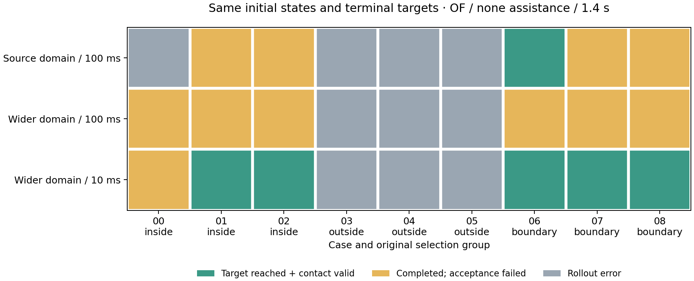
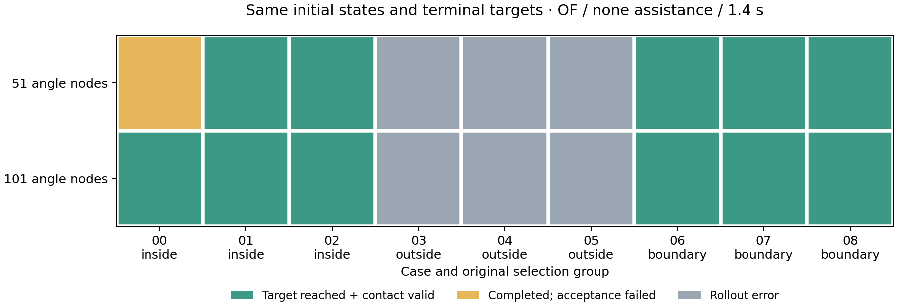
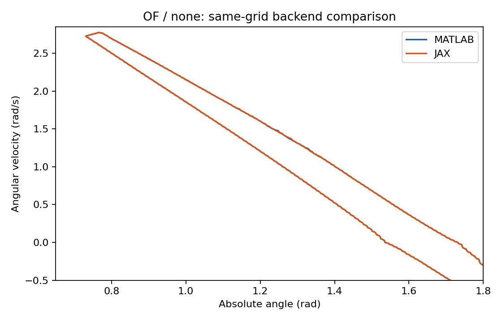
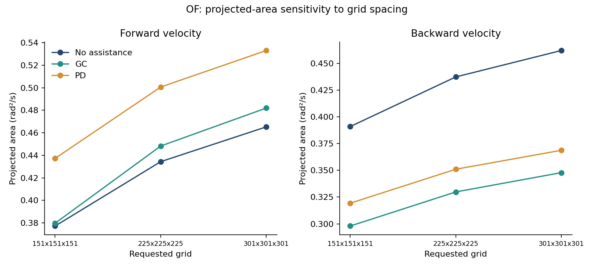
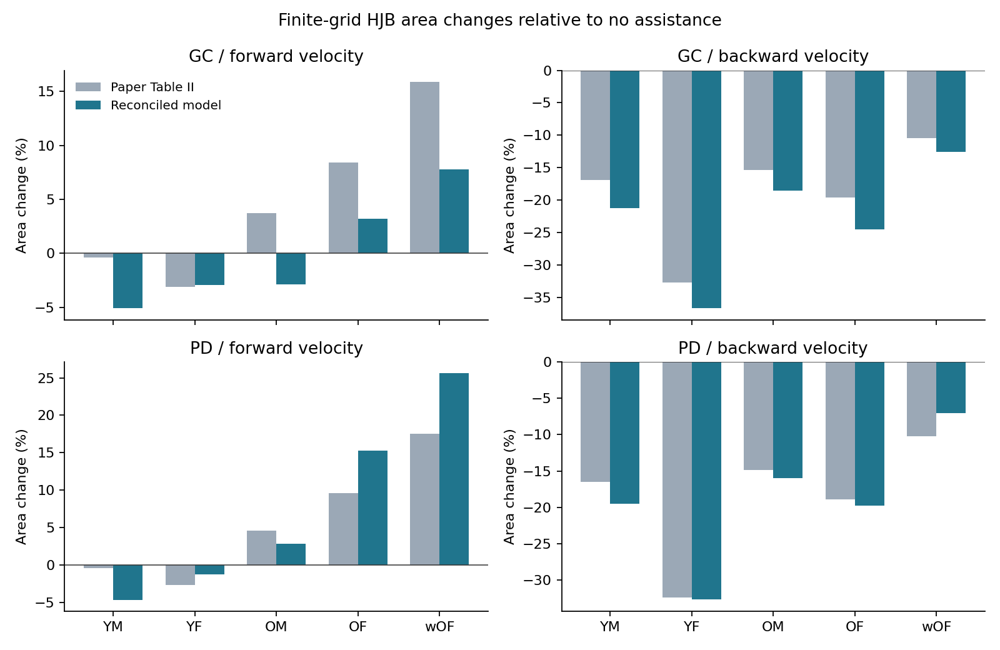
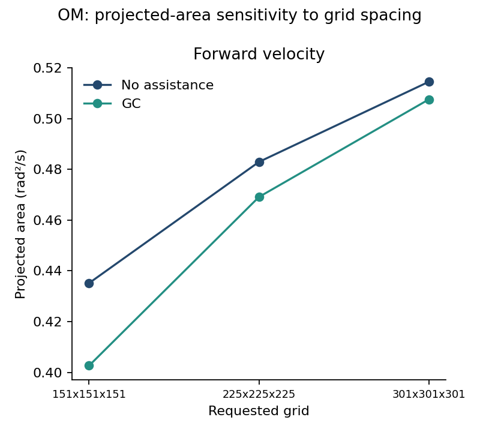

# Measured results — October 22–23, 2026

MuJoCo experiments use Python 3.11 and MuJoCo 3.3.7; the optional HJB backend uses
Python 3.12 and JAX, with MATLAB R2026b preparing its fields. Per-run versions and
complete numerical/video snapshots are in [results](results/).
The later [release verification](RELEASE.md) checks installation, examples and report rebuilds;
it does not repeat these numerical campaigns.
All 30 population-region solves, 180 preselected OF forward-validation cases, both spatial
studies and the OM target diagnostic are complete. The primary finite-grid comparison
differs from Table II, including one change of sign. The source-entry target diagnostic
reverses that sign at fixed grid; the spatial studies retain substantial sensitivity.
Exact published-region reproduction remains unaccepted. Complete outcomes are below.

## Mechanics and MATLAB-file transport

[Validation data](results/validation.json) records seed 240805418 and all profile parameters.

- **1,500 random-state acceleration comparisons**, 300 per Table I profile: maximum
  absolute MuJoCo-versus-independent-Eq. (3) error **1.16e-9 rad/s²**.
- **15 independent ODE integration comparisons**, five profiles and three timesteps:
  halving dt approximately halves state error, as expected for the selected integrator.
  These are 0.5 s constant-torque comparisons; they do not establish long-horizon stability.
- **12,001-sample trajectory, 1,000 off-grid queries:** historical nearest-neighbor linear
  scan 1,801 µs/query versus binary-search interpolation 20.5 µs/query, **87.8×** in this run.
  The continuous-signal error also fell from 2.45e-4 to 3.12e-8 for the sinusoidal fixture.
  This is in-process lookup cost, not a MATLAB Engine or end-to-end real-time benchmark.
- **72 tests passed with MATLAB R2026b**, including five opt-in runtime/source tests.
  Three additional JAX tests pass in the separate GPU environment. The other 67 tests
  need neither MATLAB nor JAX. The added plot checks expose 14
  third-party Matplotlib/pyparsing deprecation warnings; they are not suppressed.
  These include native MuJoCo mechanics, static pressure-center/angle signs, MAT/CSV interchange,
  controller timing, legacy adapters, torque limits and synthetic HJB policy semantics.
  Both printed Table I and original-source parameter sets are checked against MuJoCo;
  mismatched HJB model/assistance/strength contracts are rejected before a rollout.
  HJB-specific execution checks preserve the initial torque, integrate held rate commands
  at each physics step, test both saturation bounds and compare the lifted trajectory to
  an independent three-state ODE at dt=2, 1 and 0.5 ms. Errors decrease by approximately
  a factor of two per halving; these analytic policy fixtures do not validate an HJB solve.

Reproduce:

```bash
python -m exobalancelab.validation --out logs/validation
pytest -q
# After successful MATLAB runtime sign-in and matching Engine installation:
# On affected Linux systems, use the runtime prefix in matlab/README.md.
EXOBALANCE_MATLAB_TEST=1 pytest -q -s tests/test_matlab_runtime.py
```

## Real MATLAB feedback and exports

MATLAB R2026b (`26.2.0.3386108`) and its matching Python Engine were executed on the
development workstation. Actual CSV/MAT v7 exports round-trip through Python; the
MATLAB HJB exporter also writes a v7.3 fixture whose SI axes and gradient-derived rate
are checked after reading it in Python. This fixture is not a solved HJB policy.

The six-second OF/no-exoskeleton comparison uses `standing_pd.m`, 1 ms physics,
10 ms control, initial lean 0.01 rad and zero initial speed. Across **600 Engine calls**,
recorded joint positions and raw human torques match the Python counterpart exactly
(maximum absolute error 0 in this run). The complete
[measurement and call latencies](results/matlab_runtime/summary.json),
[MATLAB episode](results/matlab_runtime/matlab/) and
[Python episode](results/matlab_runtime/python/) are retained.

| Engine call measurement | Result |
|---|---:|
| Median | 1.790 ms |
| 99th percentile | 2.927 ms |
| Maximum | 332.866 ms |
| Calls longer than the 10 ms control period | 3 / 600 |

All calls, including the first controller evaluation, are included; Engine process
startup is outside these call timings. This is a development-workstation sample.
The controller is suitable for simulated-time feedback, but these measurements do
**not** establish hard real-time operation. Offline replay avoids per-step Engine calls.

The independently reconstructed MATLAB nominal contact constraints were checked at
500 random states across all five profiles against native MuJoCo accelerations and
Newton–Euler force/moment reconstruction, including scaled/unscaled input agreement.
Separately, the authors' unchanged `LiftedInvPendExo.dynamics` was executed in MATLAB
for 500 random states across all five **original-source** parameter sets. Its SI-converted
angle, speed and human-torque derivatives agreed with native MuJoCo and the supplied
rate input within absolute tolerance 2e-8 per component (rad/s, rad/s², Nm/s).

To include the source-level check, provide the downloaded source paths as well as
the MATLAB runtime environment described in [the integration guide](../matlab/README.md):

```bash
EXOBALANCE_MATLAB_TEST=1 \
EXOBALANCE_HJB_SOURCE=/path/to/AnkleExoBRS \
EXOBALANCE_HJB_DEPS=/path/to/hjb_dependencies pytest -q
```

## Executed nominal HJB pipeline

The v7.3 policy reader now validates one time slice at a time and caches two adjacent
gradient slices. Streaming SHA-256 avoids allocating a second full copy of the file.
The 101×269×51×141 value history contains 1.56 GB of uncompressed values; repeating the
frozen nine-state validation used **242 MiB peak resident memory**. All nine outcomes
and every array in the six completed episodes are exactly equal to the previous reader's
results. Nonuniform-axis interpolation and rejection of nonfinite values remain tested.
[Resource measurements and equality checks](results/hjb_streaming/summary.json).

An optional disk gradient cache preserves those same nine outcomes and every recorded
array exactly. Including cache creation, the repeated validation took **42.94 s** versus
187.91 s without it, with **304 MiB peak resident memory** and a 1.56 GB cache file.
These are observed workstation timings with concurrent solver jobs. The default reader
still works without a cache. [Measurements and test record](results/hjb_gradient_cache/summary.json).

A real MATLAB/helperOC solve used the unchanged authors' OF/no-exoskeleton dynamics,
native parameters (height 1.58 m, g=9.8), reconstructed C1/C3–C5 constraints and the
stored ankle/toe **box targets**. The 51×225×51 grid and 0.1 s horizon are a pipeline
check, not a converged stabilizable region. The method argument was `none`; the solve
took 75.062 s and produced 110 nonpositive terminal-grid values from 36 strictly
negative initial-target values. [Solver summary](results/hjb_nominal_0p1/summary.json).

Before forward simulation, seed 240805418 selected three admissible states from each
of the inside, outside and near-zero-value groups. Groups are disjoint; the boundary
pool consists of the 2,000 grid points with smallest absolute value. The matching
MuJoCo plant then used the exported time-dependent torque-rate policy at 1 kHz.

| Preselected group | Reached terminal target with valid contact | Other outcomes |
|---|---:|---|
| Inside | 3 / 3 | None |
| Outside | 0 / 3 | Two missed targets; one out-of-grid policy error |
| Near zero value | 1 / 3 | Two missed targets |

The successful near-zero case had a nonpositive initial value; the two missed cases
had positive values. All eight completed rollouts retained valid contact. These few
samples verify the execution chain, not boundary accuracy or a population success rate.
The [preselection protocol](results/hjb_nominal_0p1/protocol.json),
[all outcomes](results/hjb_nominal_0p1/outcomes.json), [projected values and samples](results/hjb_nominal_0p1/projection.png)
and completed episode records are retained. The first short-run export predates automatic
parameter binding; its copy was annotated with verified native parameters, with the
value-array hash unchanged. [Binding record](results/hjb_nominal_0p1/binding.json).
Full local value histories remain under ignored `logs/`; use the
[nominal solver and validation commands](../matlab/README.md#nominal-hjb-baseline)
to regenerate them (`duration_s=0.1` for this check).

The box targets follow the numerical approximation in Appendix II-B, but are not
themselves controlled invariant. This coarse, short-horizon result does not establish
the paper's full regions or an infinite-horizon invariance guarantee; see the
[target-set audit](PAPER.md#source-discrepancies-to-resolve-before-claiming-exact-reproduction).

### Longer horizon: coarse-grid prediction is not sufficient

The same nominal configuration at **1.4 s** completed in **1,003.732 s** using MATLAB's
default computational threads. It produced 19,534 nonpositive final-grid values.
This is a count of three-dimensional nodes, not a projected area or a convergence test.
The [solver summary](results/hjb_nominal_1p4/summary.json) and
[provenance](results/hjb_nominal_1p4/provenance.json) retain the configuration and hashes.


With the same selection seed and three states per group, actual MuJoCo feedback gave:

| Preselected group | Valid terminal-target reach | Completed but missed target | Policy left grid |
|---|---:|---:|---:|
| Inside | 0 | 2 | 1 |
| Outside | 0 | 0 | 3 |
| Near zero value | 1 | 2 | 0 |

All five completed episodes maintained valid contact. The four missed targets ended
with speed 0.01098–0.01236 rad/s, above the target's 0.01 rad/s limit. The successful
near-zero case had a slightly positive predicted value. These disagreements show that
this coarse value grid, sampled time history and policy execution are **not an accepted
stable-region predictor**. Spatial/time refinement and domain-buffer checks remain needed;
this experiment does not isolate which approximation causes each disagreement.

[Preselection protocol](results/hjb_nominal_1p4/protocol.json) ·
[All outcomes and final states](results/hjb_nominal_1p4/outcomes.json) ·
[Recorded episodes](results/hjb_nominal_1p4/) · [MuJoCo video](media/hjb_nominal.mp4)

The video shows `episode_01`, the first completed inside-group case. It maintains
contact but misses the terminal speed requirement; it is not labelled a recovery.

The initial forward attempt exposed a floating-point interface error: SI conversion
stored the horizon as 1.3999999999999997 s, which a strict comparison rejected against
1.4 s. A 1e-12 s time-endpoint tolerance fixes this without extrapolating physical states.
The [initial errors](results/hjb_nominal_1p4/pre_fix_outcomes.json) are retained, and the
same nine states were rerun after the fix. A regression test rejects genuinely missing
time coverage. The identical-parameter single-thread solve was stopped after the
default-thread solve completed; no unfinished result is used in this report.

### Controlled refinement: time-history sampling changes the outcome

The original nine states and target boxes were frozen before these comparisons. A
second solve uses Appendix III's 0.5 rad/s reverse-velocity buffer, a 51×269×51 grid,
and a 10 ms saved time history. It took **1,314.537 s** and produced 24,878 nonpositive
final-grid values. The velocity grid now includes zero; both its spacing and domain
changed relative to the baseline, so this is not an isolated buffer experiment.

To isolate **exported time resolution**, every tenth slice of that same solved value
history was retained to form a 100 ms policy. All 15 retained value arrays, spatial axes,
model parameters and time coordinates are bit-for-bit identical to their counterparts
in the 10 ms export. [Identity check and hashes](results/hjb_refinement/time_ablation_identity.json).
Physics and feedback remain at 1 kHz in all three runs.

| Policy | Valid target reach | Completed miss | Left policy grid |
|---|---:|---:|---:|
| Source domain, 51×225×51, 100 ms export | 1 / 9 | 4 / 9 | 4 / 9 |
| Wider domain, 51×269×51, 100 ms export | 0 / 9 | 6 / 9 | 3 / 9 |
| Same wider-domain solve, 10 ms export | 5 / 9 | 1 / 9 | 3 / 9 |



The denser time history resolves the terminal-speed misses in cases 01, 02 and 06–08.
All six completed wider-domain episodes retain valid contact. Case 00 now stays inside
the computational domain but ends at theta=1.591628 rad, outside the ankle target's
upper angle of 1.585262 rad. Its terminal speed, 0.004004 rad/s, is within the target.
The three outside-group cases still leave the grid and remain recorded errors.

The new value field predicts six of the frozen states inside; five meet the forward
acceptance test. This is a diagnostic cohort, not an estimated population success rate.
The unresolved inside case and spatial convergence still prevent accepting this policy
as a stabilizable-region predictor. No target was enlarged and no state was replaced.

[Per-case CSV](results/hjb_refinement/comparison/cases.csv) ·
[Aggregate results](results/hjb_refinement/comparison/summary.json) ·
[10 ms protocol and episodes](results/hjb_refinement/buffer05_dt001/) ·
[100 ms protocol and episodes](results/hjb_refinement/buffer05_dt01/) ·
[Vector figure](results/hjb_refinement/comparison/outcomes.pdf)

[Synchronized MuJoCo video](media/hjb_time_history.mp4) compares the same case 01 with
100 ms and 10 ms histories. Labels report the measured terminal target outcome; both
episodes retain valid contact. The preview and video are rendered from the saved states.

Reproduce the solve using `resolution=[51;269;51]`, `velocity_buffer_rad_s=0.5`,
and `output_step_s=0.01` in `solve_nominal_hjb`. The retained
[decimation script](results/hjb_refinement/decimate_hjb.m) produces the 100 ms export
without rerunning the PDE. Validate both with
`--protocol docs/results/hjb_nominal_1p4/protocol.json`. The comparison can also be
regenerated directly from the checked-in outcomes:

```bash
python -m exobalancelab.hjb_comparison \
  --run 'Source domain / 100 ms=docs/results/hjb_refinement/baseline' \
  --run 'Wider domain / 100 ms=docs/results/hjb_refinement/buffer05_dt01' \
  --run 'Wider domain / 10 ms=docs/results/hjb_refinement/buffer05_dt001' \
  --out logs/hjb_time_comparison
```

### Angle refinement resolves the remaining nominal target miss

Holding the velocity/torque axes, 10 ms history, 1 kHz rollout timing and original
states fixed, increasing angle nodes from 51 to 101 resolves case 00. Its terminal
state is `(1.579498 rad, 0.000808 rad/s, −4.638 Nm)`, inside the original ankle box.
All **six predicted-inside states** now reach a target with valid contact; the same
three outside-group states leave the grid. The solve took **2,552.523 s** wall time.



This closes the specific forward-rollout discrepancy in the frozen cohort, but does
not establish regional convergence. The sampled forward-velocity projected area changes
from **0.315244 to 0.344281 rad²/s**, a **9.21% increase**. These estimates integrate
the nonpositive projected-value indicator by the trapezoidal rule on each grid;
they are not the paper's Table II percentages.

[All refined outcomes and episodes](results/hjb_refinement/theta101/) ·
[Area definition, values and projection hashes](results/hjb_refinement/angle_refinement.json) ·
[Paired CSV](results/hjb_refinement/angle_comparison/cases.csv).
Regenerate with `resolution=[101;269;51]`, `velocity_buffer_rad_s=0.5`,
`output_step_s=0.01`, and the original `hjb_nominal_1p4/protocol.json`.
Further angle, torque and velocity refinement and broader state sampling remain needed.

### Reconciled GC/PD pipeline and control-step precision

On October 23, the assisted HJB path was executed with a shared SI assistance law for
dynamics, contact constraints and policy binding. It uses the paper's exact GC torque
and the source's restoring PD signs, saturating the bilateral device at ±50 Nm before
nondimensionalization. Appendix II targets are recomputed with equilibrium-relative
constraint distances and checked at every box corner. These are explicit, versioned
reconciliations; they are not labelled the authors' unchanged numerical experiment.

The real MATLAB check covers **1,500 random states** across five native-source profiles
and all three assistance modes. Maximum derivative disagreement with MuJoCo is
**1.40e-9**; scaled/SI dynamics and reconstructed reactions agree. All **20 assisted
target boxes** pass their linear constraints and corner-contact checks.
[Validation record](results/assisted_hjb/validation.json) ·
[Computed target parameters](results/assisted_hjb/targets/targets.json).

Short 0.1 s OF solves exercise the complete export and forward-feedback path:

| Mode / physics and control step | Inside-group valid targets | Other six states reaching a valid target |
|---|---:|---:|
| GC / 1 ms | 3 / 3 | 0 / 6 |
| PD / 1 ms | 2 / 3 | 0 / 6 |
| Same PD policy and states / 50 μs | 3 / 3 | 0 / 6 |
| Same PD policy and states / 25 μs | 3 / 3 | 0 / 6 |

All 36 rollouts complete. GC retains valid contact in all nine states; each PD cohort
has one contact-invalid outside-group case, which remains a failed outcome. GC and PD
use separately preselected cohorts; only the three PD rows form a paired comparison.
These short solves test the integration and numerical execution, not region convergence.

The PD miss is explained by the sampled extremal-rate feedback. Case 00 starts at
17.6 Nm. With 100 nonzero rate commands over 0.1 s, the endpoint has the form
`32.4 - 0.537*n` Nm, where `n` is the number of negative-rate steps. Its smallest
possible magnitude is **0.18 Nm**, outside the unchanged ±0.009169 Nm ankle target.
At 100 μs it still misses (0.0189 Nm). At 50 and 25 μs it reaches **−0.00795 Nm**
with valid contact. This quantization statement applies to the recorded bang-bang
policy without clipping or zero-rate ticks, not to every bounded controller.

[Frozen-cohort comparison](results/assisted_hjb/precision_comparison/outcomes.png) ·
[Every outcome](results/assisted_hjb/precision_comparison/cases.csv) ·
[Case 00 step study](results/assisted_hjb/precision_case00.json).
The 1 ms cohorts retain every completed episode; the finer cohorts retain full case 00
trajectories and all nine outcomes. Full local runs and the regeneration commands in
[MATLAB integration](../matlab/README.md#reconciled-assisted-hjb) preserve the remaining arrays.
These are simulated-time computations, not evidence of 20–40 kHz wall-clock control.

## Independent GPU integration of the prepared MATLAB fields

The [optional GPU workflow](HJB_GPU.md) uses the actual MATLAB-prepared target,
constraint and drift arrays. It preserves float64, ENO3/GLF/RK3, CFL 0.8 and the
source integrator's internal stopping tolerance. A separate real-MATLAB test checks
that preparation and a native solve have identical initial fields. Independent ENO
stencil and analytical-advection tests check the GPU integration.

On the RTX 5060 Laptop GPU, same-grid comparisons gave:

| OF forward case | MATLAB / JAX wall time | Projected-area difference | Final 3D negative-set Jaccard |
|---|---:|---:|---:|
| None, 51×269×51, 1.4 s | 1,314.54 / 26.76 s | +0.274% | 0.99112 |
| None, 101×269×51, 1.4 s | 2,552.52 / 59.19 s | −0.167% | 0.99684 |
| None, 201×269×51, 1.4 s | 6,606.24 / 134.50 s | +0.0526% | 0.99938 |
| GC, 51×269×51, 0.1 s | 102.43 / 1.83 s | 0% | 1.00000 |
| PD, 51×269×51, 0.1 s | 110.91 / 1.82 s | 0% | 1.00000 |

JAX timings include history writing but exclude compilation; MATLAB timings measure
the native solver. Other workstation jobs were active, so these are observed run times,
not a controlled hardware benchmark. Floating-point stencil choices do produce different
values: the final maximum absolute field errors are 0.0151, 0.1479 and 0.2977 for the
three nominal cases, and 1.08e-5 / 4.95e-6 for GC/PD. Similar areas do not imply identical value fields.
Every saved time's error, sign disagreement, hashes and comparison figures are retained:
[51 nodes](results/hjb_gpu/nominal51/comparison.json),
[101 nodes](results/hjb_gpu/theta101/comparison.json),
[201 nodes](results/hjb_gpu/theta201/comparison.json),
[GC](results/hjb_gpu/gc_short/comparison.json), [PD](results/hjb_gpu/pd_short/comparison.json).

The native 201-node MAT export stored all 141 times together in each compressed chunk,
making repeated single-time reads expensive. A separate rechunked copy retains every
value exactly, along with the MATLAB header and dataset attributes. MATLAB `matfile`
also confirms the copy's dimensions and sampled values. The original export is retained;
both file hashes and the complete value-equality check are in the
[storage-transform record](results/hjb_gpu/theta201/storage_transform.json).



The original nine MuJoCo states were also replayed with the nominal GPU histories.
The 51-node policy has five valid target reaches, one miss and three coverage errors;
the 101-node policy has six valid reaches and the same three coverage errors. These
match the native policies' outcome counts, with all six predicted-inside states passing
at 101 nodes. [51-node outcomes](results/hjb_gpu/nominal51/outcomes.json) ·
[101-node outcomes](results/hjb_gpu/theta101/outcomes.json).
At 201 angle nodes, both backends again give six valid target reaches and three outside
coverage errors. [Native episodes](results/hjb_gpu/theta201/native_validation/) ·
[GPU episodes](results/hjb_gpu/theta201/gpu_validation/).

Grid sensitivity remains substantial: with the GPU backend, increasing angle nodes
from 101 to 201 changes the sampled forward area from 0.343706 to 0.410191 rad²/s.
At 201 angle nodes, increasing torque nodes from 51 to 101 changes it to 0.419714 rad²/s.
Increasing velocity nodes from 269 to 537 then changes it to 0.433604 rad²/s, another
3.31%. The [velocity-refined projection and configuration](results/hjb_gpu/201_537_101/)
are retained. These observations do not establish spatial convergence. The complete
population comparison below uses the separate, recorded 225³ protocol.

### Complete OF spatial study

All **18 cases** in the [recorded protocol](results/hjb_grid_study/protocol.json) completed:
requested 151³, 225³ and 301³ grids for all six assistance/direction pairs, with unchanged
physical parameters, targets and 1.4 s horizon. Actual zero-aligned dimensions and axis
extents are recorded per run.



From 225 to 301, every native-grid area increases by **5.04%–7.52%**. Interpolating
coarse values onto finer nodes within the common domain gives increases of 5.87%–8.91%,
with negative-set Jaccard overlap 0.918–0.944. The differences therefore persist when
quadrature and domain are matched. These grids do **not establish spatial convergence**.

Relative to each grid's no-assistance baseline, the four assistance comparisons change
by 0.13–0.68 percentage points over the last refinement. Their signs agree with the
paper for OF at all three grids; the 301-grid magnitudes still differ by 1.28–5.10 points.

| OF area change (%) | 151³ | 225³ | 301³ | Paper Table II |
|---|---:|---:|---:|---:|
| GC / forward | +0.66 | +3.20 | +3.59 | +8.40 |
| GC / backward | −23.78 | −24.58 | −24.70 | −19.60 |
| PD / forward | +15.93 | +15.26 | +14.58 | +9.60 |
| PD / backward | −18.32 | −19.73 | −20.18 | −18.90 |

[All absolute areas](results/hjb_grid_study/comparison/areas.csv) ·
[All 12 grid comparisons](results/hjb_grid_study/comparison/comparisons.csv) ·
[Numerical report](results/hjb_grid_study/comparison/summary.json) ·
[Vector figure](results/hjb_grid_study/comparison/grid_study.pdf).

All 42 included summaries, projections and runtime records match their
[recorded hashes](results/hjb_grid_study/comparison/files.json). Rebuilding from the
included projections reproduces all 18 area records (apart from run paths) and all
12 comparisons exactly. [Reconstruction check](results/hjb_grid_study/comparison/reconstruction_check.json).

```bash
python -m exobalancelab.hjb_regions --grid-study \
  --protocol docs/results/hjb_grid_study/comparison/curated_protocol.json \
  --out logs/of_grid_report_rebuilt
```

Replaying the original 225-grid baseline under the common solver revision also produced
an [identical complete final field](results/hjb_grid_study/baseline_replay_identity.json).

The [prepared target sampling](results/hjb_grid_study/target_sampling.json) shows that
the OF GC/PD and OM GC forward ankle boxes contain only one interior velocity node and
one interior human-torque node at each of the three resolutions. For OM at 225, the
source-entry bounds increase the torque count from one to three; the velocity count
stays one. This records how the terminal box is sampled, without establishing the cause
of the area discrepancies.

The first 301-grid attempt failed before its first saved interval when the CUDA BFC
allocator could not allocate 2.12 GiB. The [failure record](results/hjb_grid_study/allocator_repair/failure.json)
and original output remain preserved. Changing only to JAX's `platform` allocator passed
a full 225-grid replay: every final value and the NPY hash match, maximum difference is
zero, and sampled peak GPU allocation is 2,104 MiB.
[Allocator verification](results/hjb_grid_study/allocator_repair/platform_validation.json).
The revised protocols record the runtime change and new output paths; grid sizes,
float64 precision, prepared fields and numerical solver are unchanged.

### Complete 225-grid population comparison

All five profiles, three assistance modes and two velocity directions completed at the
paper's requested 225³ resolution, 1.4 s horizon and 0.5 rad/s reverse-velocity buffer.
Actual zero-aligned dimensions and domain endpoints are retained per case. This uses the
authors' parameters and stored nominal targets, with the documented reconciled GC/PD
laws and target boxes; it is not an unchanged replay of the authors' complete experiment.



Across the 20 assistance comparisons, absolute differences from Table II range from
0.15 to 8.11 percentage points. Nineteen have the same sign; **OM / GC / forward differs
in direction**, with −2.86% here versus +3.7% in the paper. The largest magnitude
differences are wOF forward: GC gives +7.80% versus +15.9%, and PD gives +25.61% versus
+17.5%. Both assistance laws reduce the backward-velocity area for every profile in
this finite-grid comparison. These results do not establish the cause of the discrepancies.

[All 30 absolute areas](results/hjb_paper225/population/areas.csv) ·
[All 20 Table II comparisons](results/hjb_paper225/population/table_ii.csv) ·
[Full numerical report](results/hjb_paper225/population/summary.json) ·
[Vector figure](results/hjb_paper225/population/table_ii.pdf).

All 60 summary/projection files match their recorded SHA-256 values. A report-only
protocol points to these included files: rebuilding it reproduces every area record
(apart from its local path) and all 20 Table II comparisons exactly.
[Reconstruction check](results/hjb_paper225/population/reconstruction_check.json) ·
[Included files and local full-field hashes](results/hjb_paper225/population/files.json).
This check verifies result transport and reporting, not HJB convergence.

Rebuild the table and figures without MATLAB or a GPU:

```bash
python -m exobalancelab.hjb_regions \
  --protocol docs/results/hjb_paper225/population/curated_protocol.json \
  --out logs/population_report_rebuilt
```

### Targeted OM spatial follow-up

All six cases in the [OM protocol](results/hjb_om_gc_followup/protocol.json) completed.
This follow-up was selected after the 225-grid sign disagreement and holds the model,
targets and solver settings fixed. It compares no assistance with GC for forward velocity.



| Requested grid | No-assistance area (rad²/s) | GC area (rad²/s) | GC change (%) |
|---|---:|---:|---:|
| 151³ | 0.435161 | 0.402629 | −7.48 |
| 225³ | 0.482945 | 0.469124 | −2.86 |
| 301³ | 0.514544 | 0.507588 | −1.35 |

The GC decrease becomes smaller but **remains opposite in sign to Table II's +3.7%**.
From 225 to 301, native areas increase by 6.54% without assistance and 8.20% with GC;
common-domain comparisons give 6.34% and 8.37%. Refinement has not resolved the sign
disagreement on the recorded grids and does not establish either area's convergence.

[Numerical report](results/hjb_om_gc_followup/comparison/summary.json) ·
[Areas](results/hjb_om_gc_followup/comparison/areas.csv) ·
[Four grid comparisons](results/hjb_om_gc_followup/comparison/comparisons.csv) ·
[Vector figure](results/hjb_om_gc_followup/comparison/grid_study.pdf).

All 16 included files match their [recorded hashes](results/hjb_om_gc_followup/comparison/files.json).
The included projections [rebuild all six area records and four comparisons exactly](results/hjb_om_gc_followup/comparison/reconstruction_check.json),
apart from run paths:

```bash
python -m exobalancelab.hjb_regions --grid-study \
  --protocol docs/results/hjb_om_gc_followup/comparison/curated_protocol.json \
  --out logs/om_grid_report_rebuilt
```

### Source-entry target diagnostic

A separate [target diagnostic](results/hjb_om_target_override/protocol.json) completed
at fixed OM/GC/forward 225-grid settings. It was selected after the sign disagreement
and source audit. The public entry's ankle bounds (±0.01 rad/s, ±1 Nm) replace the computed
widths (±0.005864663 rad/s, ±0.050244659 Nm). The ankle angle and toe target are unchanged.
MATLAB preparation preserves all ten other numerical arrays and the physical parameters
exactly; the initial target grows from 248 to 288 strictly negative grid nodes.
[Preparation evidence](results/hjb_om_target_override/preparation_check.json) ·
[Reproduction steps](HJB_GPU.md#source-entry-target-diagnostic).

| OM / forward, requested 225³ | Area (rad²/s) | Change from no assistance (%) |
|---|---:|---:|
| No assistance / stored nominal target | 0.482945 | — |
| GC / computed target | 0.469124 | −2.86 |
| GC / source-entry ankle bounds | 0.496842 | +2.88 |

The target intervention increases the GC area by **5.91%** and shifts its relative effect
by **5.74 percentage points**, reversing the sign. The resulting +2.88% is 0.82 points
below Table II's +3.7%. Thus the released entry's target override can reverse the OM
sign on this reconciled finite-grid model. This changes the terminal task; it does not
establish assistance efficacy with identical targets or identify the authors' full
experimental configuration. The primary 30-case comparison remains unchanged.

[Numerical report](results/hjb_om_target_override/summary.json) ·
[Three area records](results/hjb_om_target_override/areas.csv) ·
[Candidate files and full-field hash](results/hjb_om_target_override/files.json).
Rebuilding from included candidate/reference projections reproduces all three area records
and every metric exactly, apart from run paths.
[Reconstruction check](results/hjb_om_target_override/reconstruction_check.json).

```bash
python docs/results/hjb_om_target_override/report_target_override.py \
  docs/results/hjb_om_target_override/curated_protocol.json logs/om_target_report_rebuilt
```

### Paper-sized nominal grid and broader forward validation

The OF/no-assistance forward solve at the paper's requested 225³ resolution is complete.
Aligning zero velocity and torque gives **225×226×226 actual nodes**, with a 0.5 rad/s
reverse-velocity buffer, 1.4 s horizon and 10 ms saved history. Its sampled projected
area is **0.434381 rad²/s**; solver wall time was **687.10 s**. All three spatial axes
differ from the previous 201×537×101 grid, so their similar areas are not a nested
convergence test. [Configuration and projection](results/hjb_paper225/OF_none_forward/).

At 1 ms physics/control, the frozen nominal cohort retains six valid target reaches and
three outside-group coverage errors. Broader, separately preselected cohorts cover all
six OF assistance/direction pairs, using seed 240805418 and ten states per group.
All 180 initial states satisfy physical torque and contact limits.

Here, forward/backward identifies the solved grid. Rollout selection uses its full domain,
including the opposite-velocity buffer; the area comparison uses only the named velocity sign.

| Assistance | Grid | Step (μs) | Inside reaches | Boundary reaches | Outside reaches | Coverage errors |
|---|---|---:|---:|---:|---:|---:|
| None | Forward | 1,000 | 10 / 10 | 10 / 10 | 0 / 10 | 10 |
| None | Backward | 1,000 | 10 / 10 | 10 / 10 | 1 / 10 | 9 |
| GC | Forward | 50 | 10 / 10 | 10 / 10 | 1 / 10 | 9 |
| GC | Backward | 50 | 10 / 10 | 10 / 10 | 0 / 10 | 10 |
| PD | Forward | 25 | 10 / 10 | 9 / 10 | 1 / 10 | 9 |
| PD | Backward | 12.5 | 10 / 10 | 10 / 10 | 0 / 10 | 9 |

Reaches require both terminal-target membership and valid contact. Physics and feedback
use the same simulated-time step; these are not measured controller rates. Two other
episodes complete without a valid reach: the PD forward boundary miss and PD backward
outside failure described below. The cohorts use different states, so the counts are
not paired assistance effects or population success rates.
[All cohort counts, initial-state checks and source hashes](results/hjb_paper225/forward_validation.json).
Group labels use the full three-state value; the figures project over human torque.
Replay a cohort with its saved `protocol.json` passed to `hjb_validation --protocol`,
using the table's step for both `--dt` and `--control-period` and a new output directory.

In the nominal forward cohort, five boundary successes have slightly positive initial
values, from 1.47e-5 to 4.92e-5. Thus the sampled sign boundary still differs from forward
behavior. Coverage errors are unresolved rollouts, not proofs of physical failure. Every completed episode
retains valid contact. [All outcomes and summary](results/hjb_paper225/OF_none_forward/validation_summary.json) ·
[Frozen cohort](results/hjb_paper225/OF_none_forward/frozen/) ·
[Broader cohort and full trajectories](results/hjb_paper225/OF_none_forward/admissible/).
These samples do not establish a population success rate or a maximal stabilizable region.

The original broad runs exposed a sampling bug: zero-aligned grid extension allowed
the sampler to select 22.0982 Nm or −88.3929 Nm, outside OF's [−88, 22] Nm bounds.
Both were rejected before integration. Corrected selection now checks torque bounds as
well as contact, and both directions were rerun with the original seed. Every completed
episode shared with the earlier cohorts has exactly equal recorded arrays. Frozen replay
preserves the original invalid states and their failures; both behaviors have regression
coverage. [Original forward cohort](results/hjb_paper225/OF_none_forward/broad/).

The corrected backward cohort has ten inside and ten boundary successes, plus one
outside success and nine coverage errors. Six successful boundary states have positive
initial values. All completed episodes maintain valid contact.
[Backward outcomes and full trajectories](results/hjb_paper225/OF_none_backward/admissible/) ·
[Original failure and equality checks](results/hjb_paper225/OF_none_backward/validation_summary.json).

GC forward includes a successful positive-value outside state (initial value 0.004553)
and six positive-value boundary successes. This discrepancy remains part
of the numerical evidence, alongside the successful inside predictions.
[GC protocol, all outcomes and episode hashes](results/hjb_paper225/OF_gc_forward/50us/) ·
[GC summary](results/hjb_paper225/OF_gc_forward/validation_summary.json).
Episode 00 is included in full; the remaining raw trajectories are retained locally and
can be regenerated from the recorded protocol.

GC backward has five positive-value boundary successes.
[Complete backward outcomes](results/hjb_paper225/OF_gc_backward/50us/) ·
[PD forward outcomes and retained examples](results/hjb_paper225/OF_pd_forward/25us/).

The PD boundary miss, case 25, ends at −0.00920357 Nm, just outside the unchanged
±0.00916863 Nm ankle target. Its angle, velocity and contact remain valid. Holding the
policy and initial state fixed, 12.5 μs and 6.25 μs steps give −0.00249107 Nm and
0.00086518 Nm respectively, both valid target reaches.
[Frozen case and both finer trajectories](results/hjb_paper225/OF_pd_forward/case25_precision/).
This diagnoses sampled feedback precision in that case; the original 30-state result
retains its miss. The finer steps were not applied to the entire cohort.

Reproduce the one-case check with `hjb_validation`, the saved `case25_precision/selection.json`,
`--dt 0.0000125 --control-period 0.0000125`, and a new output directory; repeat at
0.00000625 s. The selected examples include full NPZ arrays and model/configuration
snapshots. Redundant CSV files and the other fine-step raw episodes remain in local logs,
with their hashes and regeneration protocols retained.

PD backward at 12.5 μs also has five positive-value boundary successes. Outside case 15
has initial value 0.0212335 and completes without reaching either target; contact is valid
for only 21.77% of recorded steps. Its final speed is 0.0338195 rad/s and human torque
8.34436 Nm. This failure is retained alongside the successful inside examples.
[All backward outcomes, protocol and raw-file hashes](results/hjb_paper225/OF_pd_backward/12p5us/) ·
[Complete failure trajectory](results/hjb_paper225/OF_pd_backward/12p5us/episode_15/).

## Assistance can enlarge and shrink a fixed controller's recovery region


The OF experiment runs all **13×13 initial states × 3 modes = 507 episodes**.
The grid spans q∈[-0.08,0.20] rad and velocity∈[-0.6,0.6] rad/s; initial human torque is zero.
Every run lasts 6 s at 500 Hz physics/control. A final one-second standing interval and
C3–C5 validity for the full trajectory are required. The complete
[protocol](results/recovery/protocol.json), [per-episode CSV](results/recovery/grid.csv) and
[summary](results/recovery/summary.json) retain failures as well as successes.

| Mode | Recovered / 169 | Newly recovered vs none | Lost recovery vs none |
|---|---:|---:|---:|
| No assistance | 35 | — | — |
| GC | 32 | 9 | 12 |
| PD | 42 | 11 | 4 |

This illustrates the competing mechanisms highlighted by the paper. It is not a
reproduction of its Table II: a fixed feedback law, finite grid, six-second horizon and
zero-torque slice differ from a maximal HJB region projected over initial human torque.

```bash
python -m exobalancelab.sweep --points 13 --out logs/recovery_grid
```

## Articulated human: inspect the device's effect


[MP4](media/human.mp4) · [Torque/lean curves](media/human_signals.png) ·
[Full run records](results/human/)

OF anthropometry; 60 kg human plus 2 kg bilateral device; initial upright rest; the same
**80 N anterior chest force from 1.00 to 1.15 s** in each run; 1 kHz physics/control; 6 s total.
The physical device mass is retained in the motor-off control condition. One synthetic
human LQR, unchanged across modes, controls the six hip/knee/ankle actuators.

- Motor off: the model falls and loses the feet-in-place constraints.
- GC and PD: both return to standing with valid contact throughout the episode.
- These outcomes concern this model and controller, not clinical fall prevention.

Replaying these three fixed cases from committed implementation `0b623a5` reproduces
all **60 recorded arrays bit for bit**, including undefined CoP entries, and all three
model XML files byte for byte. [Replay configuration, source hashes and per-array checks](results/human/replay_check.json).

The 80 N demonstration was selected after exploratory runs. A broader fixed force list
is reported in full in [the 33-run force sweep](results/human_force_sweep/summary.json),
with its [protocol](results/human_force_sweep/protocol.json). Do not interpret a selected
video as a random trial or a population-level success rate. The force sweep also contains
conditions where assistance fails.

```bash
MUJOCO_GL=egl exobalance compare --model human --lean 0 --velocity 0 \
  --push 80 --duration 6 --video --out logs/human_demo
```

## Constraint failure is not always visible as a fall

[Reduced-model video](media/paper_constraints.mp4) ·
[Curves](media/paper_constraints_signals.png) · [Records](results/paper_constraints/)

The reduced model starts at q=-0.08 rad, velocity=+0.2 rad/s. Without assistance it reaches
standing while satisfying required foot reactions. With GC or PD, required contact
constraints are briefly violated even though the *fixed-foot* pendulum eventually becomes
upright. The video labels these as required reactions. The constrained model cannot show
physical foot tipping; it does not prove that the person has recovered safely.

This example was selected from the reported grid. It is not equivalent to the articulated
chest-push experiment. The `contact` extension permits the foot to move; its compliant
contacts and finite body COM inertia can yield different outcomes. Do not silently replace
one model's recovery classification with another's.

```bash
MUJOCO_GL=egl exobalance compare --model paper --lean -.08 --velocity .2 \
  --duration 6 --video --out logs/paper_constraints
```

## Provenance and remaining acceptance

Each published episode includes raw/applied torques, time-aligned states, model XML,
configuration, numerical metrics and source/model hashes. These captures were generated
from the implementation working tree before the documentation/media commit; the recorded
Git SHA names the base commit and `working_tree_dirty` makes that distinction explicit.
Model XML and full arrays make the rendered evidence directly inspectable.

Earlier development runs used a superseded forward/backward convention and are retained
only under ignored local `logs/`. They are not included in the published results above.

All recorded protocols above are complete. The target diagnostic identifies sensitivity
within this implementation; it does not determine the complete code and parameters that
generated Table II. Exact published-region reproduction and spatial convergence remain
unestablished; see [paper correspondence](PAPER.md). The articulated model remains unvalidated against
subject-specific mechanics or physical human experiments.
