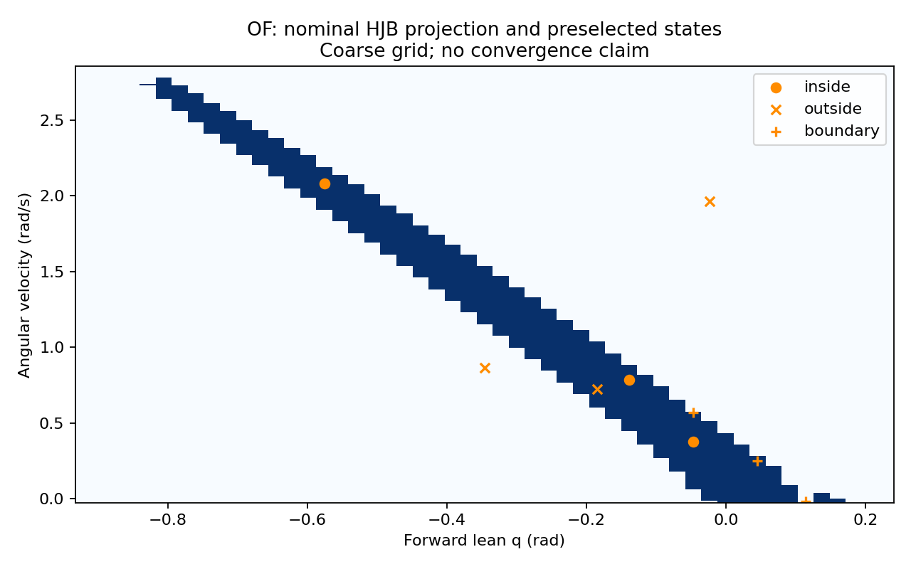
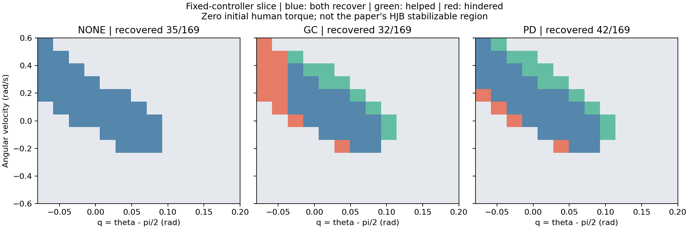
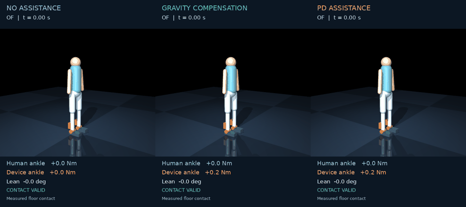

# Measured results — October 22, 2026

All results below were obtained with Python 3.11, MuJoCo 3.3.7 and the committed model
configuration files. Complete numerical/video run snapshots are in [results](results/).
The research statement is deliberately narrower than “complete reproduction”:
complete published HJB regions remain pending acceptance; real MATLAB runtime results
are now reported below.

## Mechanics and MATLAB-file transport

[Validation data](results/validation.json) records seed 240805418 and all profile parameters.

- **1,500 random-state acceleration comparisons**, 300 per Table I profile: maximum
  absolute MuJoCo-versus-independent-Eq. (3) error **1.16e-9 rad/s²**.
- **15 independent ODE integration comparisons**, five profiles and three timesteps:
  halving dt approximately halves state error, as expected for the selected integrator.
  These are 0.5 s constant-torque comparisons; they do not establish long-horizon stability.
- **12,001-sample trajectory, 1,000 off-grid queries:** historical nearest-neighbor linear
  scan 1,801 µs/query versus binary-search interpolation 20.5 µs/query, **87.8×** in this run.
  The continuous-signal error also fell from 2.45e-4 to 3.12e-8 for the sinusoidal fixture.
  This is in-process lookup cost, not a MATLAB Engine or end-to-end real-time benchmark.
- **54 tests passed with MATLAB R2026b**, including three opt-in runtime/source tests.
  The other 51 tests need no MATLAB license.
  These include native MuJoCo mechanics, static pressure-center/angle signs, MAT/CSV interchange,
  controller timing, legacy adapters, torque limits and synthetic HJB policy semantics.
  Both printed Table I and original-source parameter sets are checked against MuJoCo;
  mismatched HJB model/assistance/strength contracts are rejected before a rollout.
  HJB-specific execution checks preserve the initial torque, integrate held rate commands
  at each physics step, test both saturation bounds and compare the lifted trajectory to
  an independent three-state ODE at dt=2, 1 and 0.5 ms. Errors decrease by approximately
  a factor of two per halving; these analytic policy fixtures do not validate an HJB solve.

Reproduce:

```bash
python -m exobalancelab.validation --out logs/validation
pytest -q
# After successful MATLAB runtime sign-in and matching Engine installation:
# On affected Linux systems, use the runtime prefix in matlab/README.md.
EXOBALANCE_MATLAB_TEST=1 pytest -q -s tests/test_matlab_runtime.py
```

## Real MATLAB feedback and exports

MATLAB R2026b (`26.2.0.3386108`) and its matching Python Engine were executed on the
development workstation. Actual CSV/MAT v7 exports round-trip through Python; the
MATLAB HJB exporter also writes a v7.3 fixture whose SI axes and gradient-derived rate
are checked after reading it in Python. This fixture is not a solved HJB policy.

The six-second OF/no-exoskeleton comparison uses `standing_pd.m`, 1 ms physics,
10 ms control, initial lean 0.01 rad and zero initial speed. Across **600 Engine calls**,
recorded joint positions and raw human torques match the Python counterpart exactly
(maximum absolute error 0 in this run). The complete
[measurement and call latencies](results/matlab_runtime/summary.json),
[MATLAB episode](results/matlab_runtime/matlab/) and
[Python episode](results/matlab_runtime/python/) are retained.

| Engine call measurement | Result |
|---|---:|
| Median | 1.790 ms |
| 99th percentile | 2.927 ms |
| Maximum | 332.866 ms |
| Calls longer than the 10 ms control period | 3 / 600 |

All calls, including the first controller evaluation, are included; Engine process
startup is outside these call timings. This is a development-workstation sample.
The controller is suitable for simulated-time feedback, but these measurements do
**not** establish hard real-time operation. Offline replay avoids per-step Engine calls.

The independently reconstructed MATLAB nominal contact constraints were checked at
500 random states across all five profiles against native MuJoCo accelerations and
Newton–Euler force/moment reconstruction, including scaled/unscaled input agreement.
Separately, the authors' unchanged `LiftedInvPendExo.dynamics` was executed in MATLAB
for 500 random states across all five **original-source** parameter sets. Its SI-converted
angle, speed and human-torque derivatives agreed with native MuJoCo and the supplied
rate input within absolute tolerance 2e-8 per component (rad/s, rad/s², Nm/s).

To include the source-level check, provide the downloaded source paths as well as
the MATLAB runtime environment described in [the integration guide](../matlab/README.md):

```bash
EXOBALANCE_MATLAB_TEST=1 \
EXOBALANCE_HJB_SOURCE=/path/to/AnkleExoBRS \
EXOBALANCE_HJB_DEPS=/path/to/hjb_dependencies pytest -q
```

## Executed nominal HJB pipeline

A real MATLAB/helperOC solve used the unchanged authors' OF/no-exoskeleton dynamics,
native parameters (height 1.58 m, g=9.8), reconstructed C1/C3–C5 constraints and the
stored ankle/toe **box targets**. The 51×225×51 grid and 0.1 s horizon are a pipeline
check, not a converged stabilizable region. The method argument was `none`; the solve
took 75.062 s and produced 110 nonpositive terminal-grid values from 36 strictly
negative initial-target values. [Solver summary](results/hjb_nominal_0p1/summary.json).

Before forward simulation, seed 240805418 selected three admissible states from each
of the inside, outside and near-zero-value groups. Groups are disjoint; the boundary
pool consists of the 2,000 grid points with smallest absolute value. The matching
MuJoCo plant then used the exported time-dependent torque-rate policy at 1 kHz.

| Preselected group | Reached terminal target with valid contact | Other outcomes |
|---|---:|---|
| Inside | 3 / 3 | None |
| Outside | 0 / 3 | Two missed targets; one out-of-grid policy error |
| Near zero value | 1 / 3 | Two missed targets |

The successful near-zero case had a nonpositive initial value; the two missed cases
had positive values. All eight completed rollouts retained valid contact. These few
samples verify the execution chain, not boundary accuracy or a population success rate.
The [preselection protocol](results/hjb_nominal_0p1/protocol.json),
[all outcomes](results/hjb_nominal_0p1/outcomes.json), [projected values and samples](results/hjb_nominal_0p1/projection.png)
and completed episode records are retained. The first short-run export predates automatic
parameter binding; its copy was annotated with verified native parameters, with the
value-array hash unchanged. [Binding record](results/hjb_nominal_0p1/binding.json).
Full local value histories remain under ignored `logs/`; use the
[nominal solver and validation commands](../matlab/README.md#nominal-hjb-baseline)
to regenerate them (`duration_s=0.1` for this check).

The box targets follow the numerical approximation in Appendix II-B, but are not
themselves controlled invariant. This coarse, short-horizon result does not establish
the paper's full regions or an infinite-horizon invariance guarantee; see the
[target-set audit](PAPER.md#source-discrepancies-to-resolve-before-claiming-exact-reproduction).

### Longer horizon: coarse-grid prediction is not sufficient

The same nominal configuration at **1.4 s** completed in **1,003.732 s** using MATLAB's
default computational threads. It produced 19,534 nonpositive final-grid values.
This is a count of three-dimensional nodes, not a projected area or a convergence test.
The [solver summary](results/hjb_nominal_1p4/summary.json) and
[provenance](results/hjb_nominal_1p4/provenance.json) retain the configuration and hashes.



With the same selection seed and three states per group, actual MuJoCo feedback gave:

| Preselected group | Valid terminal-target reach | Completed but missed target | Policy left grid |
|---|---:|---:|---:|
| Inside | 0 | 2 | 1 |
| Outside | 0 | 0 | 3 |
| Near zero value | 1 | 2 | 0 |

All five completed episodes maintained valid contact. The four missed targets ended
with speed 0.01098–0.01236 rad/s, above the target's 0.01 rad/s limit. The successful
near-zero case had a slightly positive predicted value. These disagreements show that
this coarse value grid, sampled time history and policy execution are **not an accepted
stable-region predictor**. Spatial/time refinement and domain-buffer checks remain needed;
this experiment does not isolate which approximation causes each disagreement.

[Preselection protocol](results/hjb_nominal_1p4/protocol.json) ·
[All outcomes and final states](results/hjb_nominal_1p4/outcomes.json) ·
[Recorded episodes](results/hjb_nominal_1p4/) · [MuJoCo video](media/hjb_nominal.mp4)

The video shows `episode_01`, the first completed inside-group case. It maintains
contact but misses the terminal speed requirement; it is not labelled a recovery.

The initial forward attempt exposed a floating-point interface error: SI conversion
stored the horizon as 1.3999999999999997 s, which a strict comparison rejected against
1.4 s. A 1e-12 s time-endpoint tolerance fixes this without extrapolating physical states.
The [initial errors](results/hjb_nominal_1p4/pre_fix_outcomes.json) are retained, and the
same nine states were rerun after the fix. A regression test rejects genuinely missing
time coverage. The identical-parameter single-thread solve was stopped after the
default-thread solve completed; no unfinished result is used in this report.

## Assistance can enlarge and shrink a fixed controller's recovery region



The OF experiment runs all **13×13 initial states × 3 modes = 507 episodes**.
The grid spans q∈[-0.08,0.20] rad and velocity∈[-0.6,0.6] rad/s; initial human torque is zero.
Every run lasts 6 s at 500 Hz physics/control. A final one-second standing interval and
C3–C5 validity for the full trajectory are required. The complete
[protocol](results/recovery/protocol.json), [per-episode CSV](results/recovery/grid.csv) and
[summary](results/recovery/summary.json) retain failures as well as successes.

| Mode | Recovered / 169 | Newly recovered vs none | Lost recovery vs none |
|---|---:|---:|---:|
| No assistance | 35 | — | — |
| GC | 32 | 9 | 12 |
| PD | 42 | 11 | 4 |

This illustrates the competing mechanisms highlighted by the paper. It is not a
reproduction of its Table II: a fixed feedback law, finite grid, six-second horizon and
zero-torque slice differ from a maximal HJB region projected over initial human torque.

```bash
python -m exobalancelab.sweep --points 13 --out logs/recovery_grid
```

## Articulated human: inspect the device's effect



[MP4](media/human.mp4) · [Torque/lean curves](media/human_signals.png) ·
[Full run records](results/human/)

OF anthropometry; 60 kg human plus 2 kg bilateral device; initial upright rest; the same
**80 N anterior chest force from 1.00 to 1.15 s** in each run; 1 kHz physics/control; 6 s total.
The physical device mass is retained in the motor-off control condition. One synthetic
human LQR, unchanged across modes, controls the six hip/knee/ankle actuators.

- Motor off: the model falls and loses the feet-in-place constraints.
- GC and PD: both return to standing with valid contact throughout the episode.
- These outcomes concern this model and controller, not clinical fall prevention.

The 80 N demonstration was selected after exploratory runs. A broader fixed force list
is reported in full in [the 33-run force sweep](results/human_force_sweep/summary.json),
with its [protocol](results/human_force_sweep/protocol.json). Do not interpret a selected
video as a random trial or a population-level success rate. The force sweep also contains
conditions where assistance fails.

```bash
MUJOCO_GL=egl exobalance compare --model human --lean 0 --velocity 0 \
  --push 80 --duration 6 --video --out logs/human_demo
```

## Constraint failure is not always visible as a fall

[Reduced-model video](media/paper_constraints.mp4) ·
[Curves](media/paper_constraints_signals.png) · [Records](results/paper_constraints/)

The reduced model starts at q=-0.08 rad, velocity=+0.2 rad/s. Without assistance it reaches
standing while satisfying required foot reactions. With GC or PD, required contact
constraints are briefly violated even though the *fixed-foot* pendulum eventually becomes
upright. The video labels these as required reactions. The constrained model cannot show
physical foot tipping; it does not prove that the person has recovered safely.

This example was selected from the reported grid. It is not equivalent to the articulated
chest-push experiment. The `contact` extension permits the foot to move; its compliant
contacts and finite body COM inertia can yield different outcomes. Do not silently replace
one model's recovery classification with another's.

```bash
MUJOCO_GL=egl exobalance compare --model paper --lean -.08 --velocity .2 \
  --duration 6 --video --out logs/paper_constraints
```

## Provenance and remaining acceptance

Each published episode includes raw/applied torques, time-aligned states, model XML,
configuration, numerical metrics and source/model hashes. These captures were generated
from the implementation working tree before the documentation/media commit; the recorded
Git SHA names the base commit and `working_tree_dirty` makes that distinction explicit.
Model XML and full arrays make the rendered evidence directly inspectable.

Earlier development runs used a superseded forward/backward convention and are retained
only under ignored local `logs/`. They are not included in the published results above.

Pending: reconcile the upstream source discrepancies and reproduce the original HJB regions
with convergence/area comparisons. See [paper acceptance](PAPER.md). The articulated model
also remains unvalidated against subject-specific mechanics or physical human experiments.
