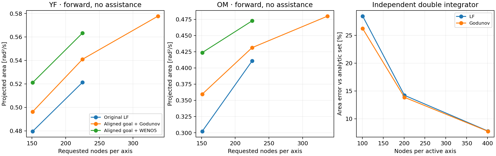

# Spatial convergence

**The spatial gate remains open.** This follow-up isolates target representation,
quadrature, numerical flux and grid resolution. It implements and runs candidate
repairs while retaining the physical goals and original error standards. The
[historical 70-solve campaign](VALIDATION.md) is unchanged.

[Measured comparisons](results/spatial_v2/report/comparisons.csv) ·
[Machine-readable report](results/spatial_v2/report/summary.json) ·
[Inputs and provenance](results/spatial_v2/README.md)

The curated set contains **27 new three-state solves**, four original reference solves,
and six independent analytic-reference runs. Both requested 337³ refinements completed.

## Fixed acceptance

All three requirements from [validation v1](../experiments/validation_v1.json) are required:

| Measurement | Requirement |
|---|---:|
| Native projected-area difference, relative to the finer grid | ≤2% |
| Change in GC's area effect relative to its matched unassisted case | ≤1 percentage point |
| Projected-set IoU on the common 601 × 601 grid | ≥0.98 |

Area remains the native trapezoidal integral of `min_torque(V) <= 0`, restricted to the
selected velocity sign. IoU uses linear interpolation of the two projected fields.
No goal is enlarged, no inside state is substituted, and float64 is retained.
The report rejects changes to the original thresholds.

The two preselected diagnostic families are **YF / source-entry** and **OM / common
ankle**, both unassisted and forward. They are diagnostic pilots, not a replacement
for the original 18-family acceptance matrix. GC-effect acceptance is not evaluated
by an unassisted pilot, even if its area and IoU were to pass.

## What the isolation experiments establish

| Source of error | Evidence | Finding |
|---|---|---|
| Native area quadrature | Re-evaluate original fields on a common 1201² physical grid | Large differences remain; native cell counting is not the main cause |
| Thin-target representation | Inspect linear interpolation through the ankle center | At OM/151, represented angle and speed widths are 44.87% and 52.34% too small |
| Control flux | Compare an asymmetric interval expansion against its exact solution | Global LF dissipation can erase a thin negative target; exact Godunov retains the interior |
| Spatial transport | Refine angle, speed and torque separately with other axes fixed at 225 | Every direction still changes the projected area by more than 2% |
| Physics-independent reference | Solve a double integrator with an analytic reachable set | Shrinkage also occurs without MATLAB, human parameters or contact constraints |

The centerline geometry check concerns the sampled field's **linear representation**.
ENO uses higher-order reconstruction; this check alone does not assign the whole PDE
error to goal geometry. The independent reference and the axis refinements establish
that substantial transport/discretization error remains after the geometry change.
The checked stencils and coordinate transformations do not reveal a sign or units error.

## Implemented changes

- **Frozen physical goals.** MATLAB can load the exact earlier target parameters instead
  of solving the SDP again. A legacy-mode call that would ignore this file is rejected.
- **Normalized box field and equilibrium alignment.** The optional field
  `min(w) * (max_i(abs(x_i-c_i)/w_i) - 1)` has the same analytic box and signs.
  Aligning the uniform angle axis at `pi/2` complements zero-speed/zero-torque alignment.
  The four pilot centerline width errors fall below **1e-12%**. All 36 prepared
  target/strength fields agree with the independent Python construction within
  **2.22e-16**, with identical analytic target/contact node classifications.
- **Exact control flux.** `--flux godunov` evaluates the extrema of the concave
  Hamiltonian `min(u_min*p, u_max*p)` between the one-sided derivatives. Drift remains
  upwind; integration remains ENO3, SSP-RK3 and float64. A numerical limiter keeps
  each stage above the **sampled** minimum `min(initial)`; it is not a bound on error
  relative to the continuous physical goal. The default LF backend is preserved for reproduction.
- **Lower memory use.** Derivatives no longer retain an unused dense coordinate array.
  Both fluxes produce a bitwise-identical first saved field on the 151³ YF input;
  this is a memory check, not an accuracy improvement.

A mapped-grid option is retained for explicit diagnostics. It uses uniform computational
coordinates and the analytic mapping Jacobian in the drift. It is not the default or
an accepted convergence repair. WENO5 is a recorded experimental source snapshot.

## Measured comparisons

Requested 151³ → 225³, identical physical goals within each comparison:

| Variant | YF area error / IoU | OM area error / IoU |
|---|---:|---:|
| Original LF | 8.01% / 0.9134 | 26.43% / 0.7255 |
| Godunov only, original fields, no lower-bound clip | 5.87% / 0.9295 | 23.89% / 0.7510 |
| Normalized/aligned goals + bounded Godunov | 8.26% / 0.9112 | 16.63% / 0.8220 |
| Same goals + Godunov/WENO5 | 7.49% / 0.9198 | 10.36% / 0.8833 |
| Mapped grid + Godunov/ENO3 | 10.62% / 0.8837 | 10.82% / 0.8701 |

Every listed pair fails the original area/IoU requirements. A larger region is not,
by itself, evidence of higher accuracy; improvements are not uniform across families.

The next uniform refinement retains the normalized/aligned goals, Godunov/ENO3,
CFL 0.8 and identical solver source on both grids:

| Requested 225³ → 337³ | Area difference | IoU | Result |
|---|---:|---:|---|
| YF / source-entry | **6.36%** | **0.93590** | Fail |
| OM / common ankle | **10.13%** | **0.90209** | Fail |

Refinement reduces the differences, but neither pair meets 2% / 0.98. The repair is
incomplete. Remaining work concerns thin-target transport and constraint/time sensitivity;
there is no measured basis for declaring the full 18-family matrix converged.

The new Godunov candidate also requires its own time check. At requested 151³, with
the original temporal limits of ≤0.5% area difference and IoU ≥0.995:

| Case / CFL refinement | Area difference | IoU | Result |
|---|---:|---:|---|
| YF · 0.8 → 0.4 | 0.0345% | 0.99616 | Pass |
| OM · 0.8 → 0.4 | 0.2387% | 0.98890 | Fail |
| OM · 0.4 → 0.2 | 0.0954% | 0.99190 | Fail |

The OM shape remains time-sensitive despite small area changes. The old LF campaign's
2/2 time result does not transfer to this new method. Removing the inherited 1e-4
end-of-interval stopping tolerance gives **bitwise-identical complete OM fields** at
CFL 0.8 and 0.4, ruling out that tolerance for these failures. The Godunov option remains
experimental; it has not met combined spatial and temporal acceptance.

For YF, increasing only one requested dimension from 225 to 449 gives:

| Refined dimension | Area change | IoU with 225³ |
|---|---:|---:|
| Angle | 3.29% | 0.9658 |
| Angular velocity | 3.83% | 0.9601 |
| Human torque | 4.01% | 0.9621 |



The independent double integrator uses `x_dot=v`, `v_dot=u`, `u∈[-1,1]`, a 0.5 s
horizon, and the unchanged terminal box `abs(x)<=0.005`, `abs(v)<=0.01`.
Its analytic position bounds follow from the one-switch extrema of integrated
acceleration; an independent linear-program control discretization checks the formula.
At 101, 201 and 401 nodes per active axis, Godunov's area errors against the analytic
set are **26.21%, 13.86% and 7.75%**. Thus merely replacing LF with Godunov does not
resolve thin-target transport. These are absolute reference errors, distinct from the
paper campaign's differences between two grids.

A float32 probe was also rejected: area difference **0.0690%**, IoU **0.99728** against
the identical float64 input. It fails the predeclared precision guard of ≤0.1% and
IoU ≥0.999. Lower precision is not used to fit a larger grid.

## Reproduce and inspect

Rebuild all curated comparisons and the figure in the basic environment:

```bash
python -m examples.report_spatial --out logs/spatial_report
```

Run the independent numerical reference in the [JAX environment](HJB_GPU.md):

```bash
python -m examples.hjb_analytic_reference --platform cpu --out logs/analytic_reference
```

For a new uniform YF solve, prepare the exact frozen goal in MATLAB:

```matlab
addpath('matlab');
solve_paper_hjb('/path/to/AnkleExoBRS', 'logs/hjb_dependencies', ...
    'logs/spatial_YF_225', profile="YF", exo="none", direction="forward", ...
    resolution=[225;225;225], target_definition="source_entry", ...
    frozen_target_file="docs/results/spatial_v2/solves/aligned_godunov_YF_225/frozen_target.mat", ...
    target_field="width_normalized", align_upright=true, align_zero=true, prepare_only=true);
```

```bash
python -m exobalancelab.hjb_solver --problem logs/spatial_YF_225/problem.mat \
  --out logs/spatial_YF_225_solved --flux godunov --projection-only
```

The full-matrix preparation/solve wrapper is `examples.spatial_convergence`, using
[the unchanged-threshold protocol](../experiments/spatial_convergence_v2.json). All 36
inputs were prepared; the full matrix was not rerun after the diagnostic pairs failed.
Full 3D fields and discarded exploratory runs remain in local `logs/`; compact
projections, goals, sources and measured failures are curated in the repository.

The flux follows the Hamilton–Jacobi upwinding framework of
[Osher and Sethian](https://math.berkeley.edu/~sethian/2006/Papers/sethian.osher.88.pdf).
The work remains numerical validation of the existing research, without a new-paper claim.
