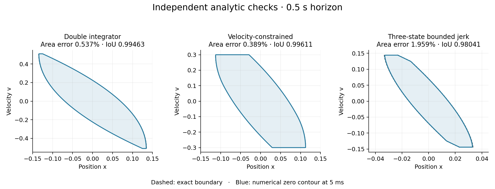
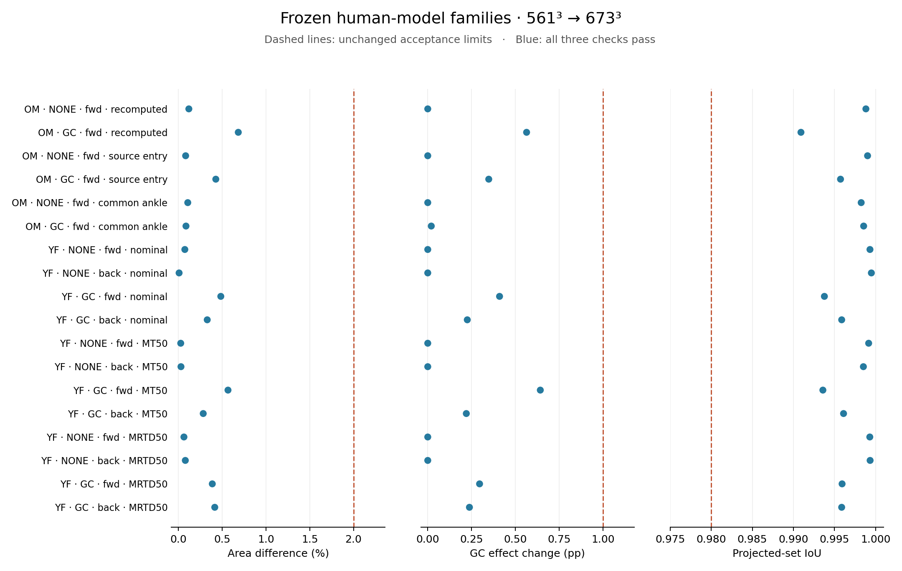

# Numerical transport and convergence

This follow-up repairs thin-target propagation and checks the same 18 human-model
families against the [original acceptance criteria](../experiments/validation_v1.json).
The earlier [spatial diagnosis](SPATIAL_CONVERGENCE.md) and its failed runs are retained.
All **38 local GPU solves** are complete: **18/18 spatial comparisons and 2/2 time
pilots pass**, with no change to the original thresholds, physical goals or constraints.

## Acceptance and scope

| Check | Original requirement |
|---|---:|
| Native projected-area difference, relative to the finer grid | ≤2% |
| Change in GC's effect against the matched unassisted baseline | ≤1 percentage point |
| Projected-set IoU on the common 601 × 601 grid | ≥0.98 |
| Time-step area difference | ≤0.5% |
| Time-step projected-set IoU | ≥0.995 |

All three spatial requirements must pass for **every one of the original 18 families**
at a common refinement pair. The time pilots remain YF/source-entry and OM/common-ankle,
unassisted and forward. Area remains native trapezoidal integration of
`min_torque(V) <= 0`, restricted to the selected velocity sign. IoU still uses linear
interpolation on the original common physical grid. There is no zero-level tolerance,
goal enlargement or switch to float32.

These are finite-horizon reach-avoid computations for the reduced human model, with
unchanged C1/C3–C5 constraints and independent MT/MRTD limits. Passing the operational
criteria does not establish asymptotic convergence, box invariance, exact Table II
reproduction or transfer to the articulated MuJoCo model. The new backend exports
convergence fields; earlier feedback policies and rollout outcomes remain historical.

## What was repaired

1. **Resolve each terminal goal independently.** A grid covering both equilibria can
   miss a narrow goal even when the combined domain looks adequately resolved. In the
   OM/GC recomputed case, the shared 225³ initial grid contains **zero** negative ankle
   target nodes: its torque half-width is about **0.05024 Nm**. Each box now begins on
   its own tightly enclosing grid. Their propagated values combine by a pointwise
   minimum after both grids reach the original final domain. Taking this minimum
   preserves the original union of terminal goals.
2. **Propagate along split characteristics.** Human torque evolves through the full
   admissible torque-rate interval; angle transport is a translation, and angular
   velocity uses the exact damped flow with fixed angle and torque. Symmetric Strang
   composition couples these flows. Bounded cubic ENO interpolation supplies values
   between nodes; control searches include all intervening nodes, not just endpoints.
   Contact constraints are applied after every split operator.
3. **Keep the expanding boundary extension continuous.** A constant positive exterior
   introduced a jump that contaminated interpolation and eroded thin reachable sets.
   The repaired extension connects to the boundary value and remains positive outside
   a still-expanding enclosure. At the original domain boundary, the inherited
   away-from-zero extension is retained. No sign threshold is shifted.

The initial enclosure has twice the physical box half-widths; it is a **computational
domain**, not an enlarged goal. Exact backward bounds for each split flow expand it
until it reaches the original MATLAB-prepared domain. No terminal SDP is rerun.

The implementation is [hjb_transport.py](../exobalancelab/hjb_transport.py).
The full-input audit compares **18,000 sampled states** with the actual MATLAB-prepared
fields: maximum drift/constraint discrepancy **3.55e-15**, below its 1e-12 check.
Every target, effective strength profile, target definition and 1.4 s horizon matches
its original validation input.
An additional endpoint audit checks all 34 distinct goal enclosures at both time
steps. All 68 configurations reach the full physical domain by 1.4 s, with zero
endpoint discrepancy. This checks computational-domain coverage separately from
value-field accuracy.

## Independent analytic checks

Three independent references use the same numerical operators as the human model:

- **Double integrator:** `x_dot=v`, `v_dot=u`, `abs(u)<=1`, a 0.5 s horizon,
  and the thin goal `abs(x)<=0.005`, `abs(v)<=0.01`.
- **Constrained double integrator:** the same problem with `abs(v(t))<=0.3`
  throughout. Integrating the attainable envelope `min(v+t, 0.3, 0.01+T-t)`
  and its reflection gives exact displacement bounds.
- **Triple integrator:** `x_dot=v`, `v_dot=a`, `a_dot=u`, `abs(u)<=1` and a
  0.5 s horizon, with terminal half-widths `(0.005, 0.01, 0.02)`. Its exact
  projected boundary comes from bounded-jerk control with a single switching time.
  This exercises all three coupled state coordinates; passing the two-state
  examples alone did not diagnose its propagation error.

Independent linear programs check the constrained and three-state analytic formulas.
The reference fields are compared with exact sets on a common 601 × 601 physical grid,
including the unreachable exterior. Absolute area errors and IoU are distinct from
human-model differences between two numerical grids. The required cohort also checks
spatial refinement and step halving against the unchanged thresholds.

| Exact reference | Grid | Maximum absolute area error | Minimum IoU | Step-halving area difference / IoU |
|---|---:|---:|---:|---:|
| Double integrator | 801² | 0.537% | 0.99463 | 0.051% / 0.99949 |
| With velocity constraint | 801² | 0.389% | 0.99611 | 0.100% / 0.99895 |
| Three-state bounded jerk | 561³, 673³ | 1.959% | 0.98041 | 0.399% / 0.99603 |



The primary time step is 10 ms, compared with 5 ms at the finest grid. The three-state
561³→673³ spatial difference is **0.350%**, with IoU **0.99650**. All required analytic
checks pass. The additional continuous-area check gives a worst error of **1.977%**,
also below 2%; the pass is not an artifact of the 601 × 601 reference raster.
At fixed 673³, step halving changes the absolute reference area error from 1.568%
to 1.959%. More interpolation steps need not improve a fixed spatial grid; these are
jointly validated grid/time settings, not a claim of monotone error reduction for
arbitrarily small time steps. Coarser three-state runs remain failures: at 449³ and 10 ms the absolute
area error is [2.59%](results/transport_v3/coarse_reference/README.md), despite the two-state examples already passing. These results
motivate the finer human-model campaign rather than a relaxed threshold.

An alternative initial enclosure with just one grid cell around each goal was also
rejected. Its OM/GC recomputed spatial difference was **4.111% / 0.95426 IoU**;
OM/common-ankle gave **3.465% / 0.96354** spatially and **2.673% / 0.97404** on
step halving. The [failed candidate's five fields and rebuild script](results/transport_v3/rejected_halo/README.md)
retain those results and their actual source snapshots. Passing a selected analytic
case did not qualify that candidate for the human-model campaign.

## Human-model measurements

The protocol covers YF none/GC × forward/backward × nominal/MT50/MRTD50, plus OM
none/GC × recomputed/source-entry/common-ankle targets. Actual compact projections,
source snapshots, frozen inputs and complete acceptance tables are retained in the
[curated dataset](results/transport_v3/README.md). All runs used the current laptop's
RTX 5060 Laptop GPU (8 GB); no remote compute was used.

Every family passes at **561³→673³, 10 ms**, over the unchanged 1.4 s horizon:

| Cohort | Passed | Maximum area difference | Maximum GC effect change | Minimum IoU |
|---|---:|---:|---:|---:|
| YF nominal | 4/4 | 0.485% | 0.410 pp | 0.99377 |
| YF MT50 | 4/4 | 0.567% | 0.643 pp | 0.99359 |
| YF MRTD50 | 4/4 | 0.416% | 0.296 pp | 0.99587 |
| OM, three goal definitions | 6/6 | 0.684% | 0.564 pp | 0.99092 |
| Original requirement | 18/18 | ≤2% | ≤1 pp | ≥0.98 |



[All areas and signed assistance effects](results/transport_v3/report/areas.csv) ·
[Every spatial comparison](results/transport_v3/report/spatial.csv) ·
[Machine-readable acceptance](results/transport_v3/report/summary.json).

The table measures numerical refinement error, not the magnitude of assistance's
physical effect. Small signed effects should be interpreted alongside their refinement
changes. These results close the declared YF/OM spatial gate; they do not replace the
older five-population/Table II study or its different targets and grids.

Both time pilots pass at 673³ with a 10→5 ms step reduction:

| Forward, unassisted pilot | Area difference | Projected-set IoU | Result |
|---|---:|---:|---|
| OM / common ankle | 0.168% | 0.99775 | Pass |
| YF / source entry | 0.259% | 0.99691 | Pass |

These are the two diagnostic pilots selected in the spatial follow-up. The original
LF campaign's YF none/GC CFL comparisons remain separate historical results.

## Reproduce

The curated dataset supports report and figure reconstruction in the basic environment:

```bash
python -m examples.benchmark_transport --report-only \
  --out docs/results/transport_v3/analytic_reference
python -m examples.transport_convergence report --out docs/results/transport_v3
python -m examples.plot_transport_convergence \
  --reference docs/results/transport_v3/analytic_reference --out logs/transport_exact.png
python -m examples.plot_transport_convergence \
  --report docs/results/transport_v3/report/summary.json --out logs/transport_convergence.png
```

The first two commands rebuild the reports beside their recorded inputs. Their numeric
contents must match the committed summaries. The physical audit can also be replayed
without MATLAB or a GPU, using JAX on the CPU in the separate HJB environment:

```bash
JAX_PLATFORMS=cpu python -m examples.verify_transport_physics \
  --samples docs/results/transport_v3/physics --inputs docs/results/transport_v3/inputs \
  --out logs/transport_physics_recheck

JAX_PLATFORMS=cpu python docs/results/transport_v3/physics/audit_enclosures.py \
  --inputs docs/results/transport_v3/inputs --out logs/transport_enclosures.json
```

Use the [separate HJB environment](HJB_GPU.md) for numerical solves. The compact JSON
inputs contain the frozen physical problem, so repeating the transport campaign needs
neither MATLAB nor a new SDP solution. Use new output directories for new runs.

```bash
# Run the independent references before human-model experiments.
XLA_PYTHON_CLIENT_PREALLOCATE=false XLA_PYTHON_CLIENT_ALLOCATOR=bfc XLA_CLIENT_MEM_FRACTION=0.9 \
  JAX_PLATFORMS=cuda python -m examples.benchmark_transport \
  --out logs/transport_reference

# Run all 18 families, then the two time pilots.
XLA_PYTHON_CLIENT_PREALLOCATE=false XLA_PYTHON_CLIENT_ALLOCATOR=bfc XLA_CLIENT_MEM_FRACTION=0.9 \
  JAX_PLATFORMS=cuda python -m examples.transport_convergence solve \
  --prepared docs/results/transport_v3/inputs --reference logs/transport_reference \
  --out logs/transport_campaign --resolutions 561 673 --step .01

XLA_PYTHON_CLIENT_PREALLOCATE=false XLA_PYTHON_CLIENT_ALLOCATOR=bfc XLA_CLIENT_MEM_FRACTION=0.9 \
  JAX_PLATFORMS=cuda python -m examples.transport_convergence solve \
  --prepared docs/results/transport_v3/inputs --reference logs/transport_reference \
  --out logs/transport_campaign --resolutions 673 --step .005 \
  --families OM_none_forward_common_ankle_mt100_mrtd100 \
             YF_none_forward_source_entry_mt100_mrtd100

python -m examples.transport_convergence report --out logs/transport_campaign \
  --resolutions 561 673 --temporal-resolution 673
```

The implementation processes independent slabs for each operator, computes expanding
axes from global bounds, and synchronizes each slab to bound asynchronous workspace.
Initial goal/contact evaluation is fused to avoid multiple full-volume temporaries.
Full-volume operator comparisons check these execution changes separately from the
analytic accuracy checks. Wall times are provenance, not real-time benchmarks.
The slabbed backend was also checked with BFC allocation on the 8 GB GPU: all seven
analytic fields are byte-identical to the platform-allocator results, with unchanged
numerical source hashes. The three-state runs took 80.7/136.7/252.4 s instead of
93.7/155.4/290.5 s in these separate runs. The [allocation record](results/transport_v3/allocator_comparison/summary.json)
preserves both manifests and settings. Subsequent human solves use that BFC configuration;
the wrapper records explicitly selected allocation settings and otherwise defaults to
the platform allocator.
The original LF/Godunov backend remains available for reproducing earlier evidence.
