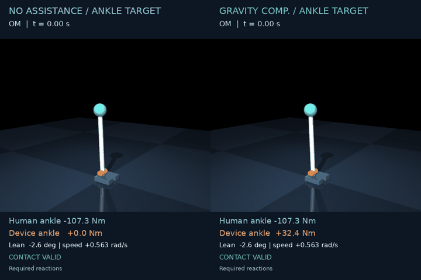

# Transport feedback in MuJoCo

This experiment connects the accepted split-transport solver to the **matched reduced
paper model** in MuJoCo. It uses the same frozen YF/OM physics and terminal sets as the
[numerical convergence campaign](TRANSPORT_CONVERGENCE.md). Articulated-human videos
have their own controller provenance; this experiment does not transfer the reduced
model's reachable sets to the 9 DoF model.

## Measured outcome

**The full closed-loop acceptance gate remains unpassed.** All 72 declared rollouts
were executed: 30 finished, 28 reached a terminal box with valid constraints, and 42
raised explicit coverage errors. Six of those errors concern three predicted-inside
state/mode cases, each repeated at both physics steps. They are retained as failures.

| Check | Recorded result |
|---|---|
| Export versus accepted final projection | **4/4 exactly equal**, including axes |
| Predicted-inside reach | **28/34 rollouts**, or **14/17 cases** at both physics steps |
| Full endpoint/classification refinement gate | **15/36 pairs pass**; 21 have incomplete trajectories |
| Completed pairs only | **15/15** meet the original endpoint and classification limits |
| Maximum endpoint differences | **8.161e-5 rad / 4.878e-5 rad/s / 0.5261 Nm** |
| Controller p99 | **0.573–0.705 ms**, all 30 completed runs within 1 ms |

The other two completed runs are the same predicted-outside YF case at both physics
steps: valid contact, missed target. Completion/error status agrees in all 36 pairs;
this does not supply missing endpoints or turn coverage errors into accepted refinements.
Controller latency is a local software measurement on an i7-14650HX, with initialization
and file hashing outside the measured calls. Physics runs offline; this is not a
hardware timing guarantee.

Fine-step results below use the fixed nine initial states in each population. Each row
is repeated at the coarser step in the full dataset.

| Plant | Completed / 9 | Predicted inside | Valid reach | Inside failures |
|---|---:|---:|---:|---:|
| OM / none | 2 | 4 | 2 | 2 |
| OM / GC | 4 | 4 | 4 | 0 |
| YF / none | 5 | 5 | 4 | 1 |
| YF / GC | 4 | 4 | 4 | 0 |

[Complete records, sources and checksums](results/transport_feedback_v2/README.md) ·
[Every outcome](results/transport_feedback_v2/outcomes.csv) ·
[Machine-readable acceptance](results/transport_feedback_v2/summary.json)

## Recorded simulations



[OM video](media/transport_om.mp4): case 00, same initial state, common ankle target,
none/GC; both reach the target with valid constraints.

[Further YF video](media/transport_yf.mp4) ·
[OM signals](results/transport_feedback_v2/figures/transport_om_signals.png) ·
[YF signals](results/transport_feedback_v2/figures/transport_yf_signals.png).
The YF case selects the **toe target** in both modes; its final forward lean is part
of that source target, not an upright-recovery criterion. Both videos follow the
predeclared selection rule and are examples, not the aggregate success rate.

## Reader repair and remaining failures

The first reader queried one fixed physical point in both neighboring time grids.
On a contracting mesh this rejected states inside a valid space-time cell. That
candidate was stopped after 15 recorded errors; its protocol, source and outcomes
remain in [the rejected-reader archive](results/transport_feedback_v2/rejected_overlap_reader/).
The repaired reader interpolates the grid at the query time and shares reference-cell
weights across the two time slices. An independent fixture tests both a valid cell
outside one endpoint grid and rejection immediately outside the interpolated domain.
The original two cohort files are byte-identical in the rerun; all limits remain unchanged.

Three predicted-inside cases still fail: **OM/none 01** (inside group), **OM/none 05**
and **YF/none 03** (boundary group). Six additional diagnostic runs tested a 0.5 ms
control period and extremal-rate selection from an interpolated unit switching
function, with the same initial states and fine physics step. Neither repaired these
failures: five coverage errors and one completed target miss. The original 1 ms
campaign remains primary. [Diagnostic records and executable source](results/transport_feedback_v2/diagnostics/)
retain these unsuccessful checks.

Passing projected-region convergence does not certify the extracted feedback at every
three-dimensional state. The remaining discrepancy needs further value-field/feedback
analysis before making that stronger claim; no target enlargement, tolerance change,
cohort replacement or substitute controller is counted as a repair.

## Policy export

The solver records every 10 ms slice on its native **673³ moving grid**, including the
terminal slice at zero remaining time. Each distinct terminal box has its own grid and
policy. The central torque derivative selects the Hamiltonian's minimum-rate,
zero-rate or maximum-rate decision. An `int8` table stores these decisions without
quantization; gzip compression is lossless. It does **not** store the full value history.
Each goal's final float64 value field is retained for initial goal selection.

At the initial state, the reader selects the goal with the smallest final value and
holds that choice throughout the episode. It first interpolates the physical grid axes at the query time, locates the state
in that grid, and uses the same reference-cell weights in both adjacent time slices.
It then blends the two native rate interpolants in time. This is bounded feedback
interpolation, not an exact continuous optimal policy. The interpolated physical grid
must cover the query. An uncovered query raises an error; no substitute controller
or extrapolation is used.

Every export checks that the final SI projection and its axes are **exactly equal** to
the corresponding accepted numerical result. The observer records the fields after
complete integration steps and does not change the integration operators.

## Frozen experiment

The [original protocol](../experiments/transport_feedback_v1.json) predates the rollouts.
The [reader repair](../experiments/transport_feedback_v2.json) retains its exact cohort,
policy files, physics/control conditions and numerical limits:

- OM: no assistance / gravity compensation, identical physical `common_ankle` target.
- YF: no assistance / gravity compensation, frozen `source_entry` ankle/toe targets.
  The complete YF target sets depend on the plant and are not identical across modes.
- Nine seeded states per population: three inside, three near the zero contour, three
  outside the baseline three-dimensional field. Initial contact, torque and policy
  domains must be admissible for both modes. All states are selected before rollouts.
- Each state runs in both modes at 12.5 and 6.25 µs physics steps: **72 episodes** and
  **36 refinement pairs**, with 1 ms control, zero command delay and a 1.4 s horizon.
- Valid reach requires membership of an original terminal box at the final time and
  valid C1/C3–C5 constraints throughout. Foot feasibility uses the required reactions
  of the fixed-foot paper model. Baseline group labels remain fixed; assisted
  reachability predictions are recorded separately.

The original limits remain **0.001 rad, 0.01 rad/s and 1 Nm** for endpoint refinement;
target/contact classifications must agree. Controller p99 must fit the **1 ms** budget.
Coverage errors remain failed/incomplete runs in the full denominator. Success rates
and numerical refinement are reported separately.

## Reproduce

Export requires the optional local JAX/CUDA environment described in
[solver setup](TRANSPORT_CONVERGENCE.md#reproduce). Use a new output directory and run
one export at a time. For each family listed in the protocol:

```bash
family=OM_none_forward_common_ankle_mt100_mrtd100
OPENBLAS_NUM_THREADS=1 XLA_PYTHON_CLIENT_PREALLOCATE=false \
  XLA_PYTHON_CLIENT_ALLOCATOR=bfc XLA_CLIENT_MEM_FRACTION=0.9 \
  JAX_PLATFORMS=cuda,cpu python -m examples.export_transport_policy \
  --problem "docs/results/transport_v3/inputs/$family.json" \
  --reference "docs/results/transport_v3/solved/${family}_n673_dt0.01" \
  --out "logs/transport_feedback/policies/$family"
```

After exporting all four families, use the basic MuJoCo environment:

```bash
python -m examples.validate_transport_feedback \
  --policies logs/transport_feedback/policies --out logs/transport_feedback/rollouts
MUJOCO_GL=egl python -m examples.render_transport_feedback \
  --source logs/transport_feedback/rollouts --out logs/transport_feedback/media
```

`exobalance run --hjb-policy path/to/policy.h5` also accepts this format. Supply the
matching profile, `--parameters authors`, assistance mode, initial state and horizon.
Use `--initial-torque` for the third initial-state coordinate. The physical contract
and full export horizon are checked before running. Policy files stay in the local
experiment directory; the public evidence retains export metadata and reproduction
inputs rather than multi-gigabyte tables.

The video rule selects the first predeclared state with completed fine-step none/GC
trajectories, in inside/boundary/outside order, independently of recovery outcome.
Recorded trajectories are sampled at 1 ms for storage and rendered at real-time speed;
metrics and acceptance use the full physics-step observations and post-step endpoint.
