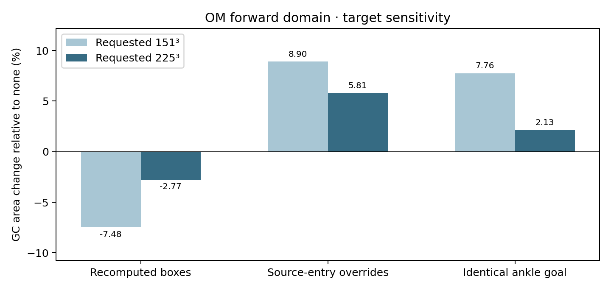
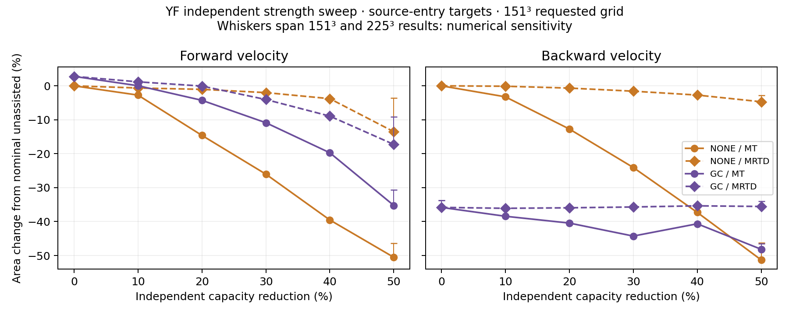
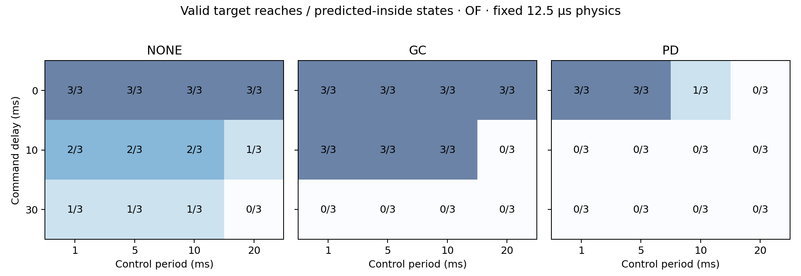
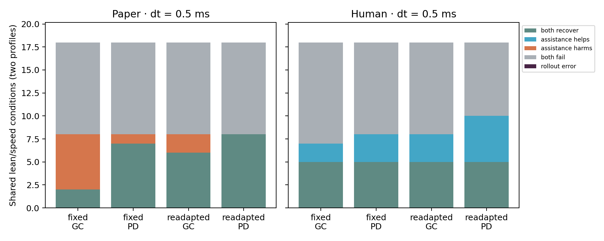
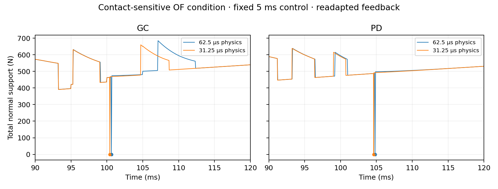
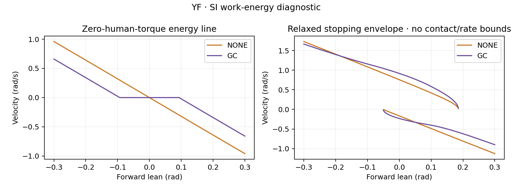

# Target, strength, timing and human-model validation

This campaign follows the four open validation questions in the existing research.
Its purpose is to make those questions executable and measurable; a new paper is not
an acceptance requirement. The frozen [protocol](../experiments/validation_v1.json)
precedes the new outcomes. Historical experiments remain unchanged.
All **70 HJB solves** and **750 primary MuJoCo episodes** completed evaluation;
12 additional contact-diagnostic episodes and 20 independent ODE runs are retained.
[Complete report](results/validation_v1/report/summary.json) ·
[Curated evidence](results/validation_v1/README.md).

## Definitions fixed before running

The HJB state is `(theta, velocity, human torque)` in rad, rad/s and Nm. All new solves
use the authors' anthropometry, gravity 9.8 m/s², a 1.4 s horizon, C1/C3–C5 constraints,
and the `none` finite-horizon set operation. Output every 0.01 s is a history interval;
the internal numerical step is determined by the CFL condition.

| Target definition | Physical task |
|---|---|
| `legacy` | Historical stored nominal/recomputed assisted targets; retained for old results |
| `recomputed` | Two boxes from the Appendix II SDP construction, with linear and corner-contact checks |
| `source_entry` | Recomputed geometry with **both** ankle/toe velocity half-widths set to 0.01 rad/s and ankle torque half-width to 1 Nm, matching the released entry's overrides |
| `common_ankle` | Identical goal across assistance modes: `abs(theta-pi/2)<=0.005`, `abs(velocity)<=0.01`, `abs(human torque)<=1`; a separate matched-task diagnostic |

Every goal is intersected with the physical constraints. `source_entry` follows the
entry's overrides while recomputing its remaining geometry for each effective plant;
it is not an unmodified execution of the authors' program. Toe equilibria remain
plant-specific. Only `common_ankle` holds the complete physical target identical across
modes. The older OM diagnostic changed only the ankle velocity/torque widths; it did
not apply the complete two-velocity override used here.

These boxes specify **finite-time terminal goals**. At their upper angle face with
positive velocity, the angle immediately increases regardless of the torque-rate input.
Therefore they are not asserted to be controlled invariant. Reaching a box by 1.4 s
does not prove that the trajectory can remain there indefinitely. No new invariant-set
theorem is claimed.
The target audit retains a concrete admissible upper-face point for each ankle goal,
including its torque bound and contact margins, so this distinction is checkable.

## Numerical acceptance

These are engineering tolerances selected for this repository, not thresholds claimed
by the source article. A failed check remains failed in the report.
Relative area error is `100*abs(A_fine-A_coarse)/A_fine`; assistance-effect error is
the absolute difference between the two grids' percentage changes relative to none.

| Check | Acceptance |
|---|---|
| Spatial refinement, requested 151³ → 225³ | Relative area difference ≤2%, GC effect change ≤1 percentage point, **and** projected-region intersection/union ≥0.98 |
| Internal time refinement, CFL 0.8 → 0.4 | Area difference ≤0.5% and projected-region intersection/union ≥0.995 |
| Rollout physics, 12.5 → 6.25 µs at fixed 1 ms control | Endpoint differences ≤0.001 rad, 0.01 rad/s and 1 Nm; target/contact classification unchanged |
| Controller computation | Recorded p99 call time ≤ the specified control period; deadline misses also retained |
| Paired-model physics, 1 → 0.5 ms at fixed 5 ms control | Report every changed recovery classification; preserve initial state and designed feedback |

Projected area integrates `min_tau(V)<=0` over the selected velocity sign. Overlap is
computed by interpolating both value projections onto the same 601×601 domain, then
restricting the velocity sign and thresholding at zero. The exported grid can gain one cell to include zero velocity and
torque. This finite comparison quantifies sensitivity; even a passing pair is not a
proof of asymptotic grid convergence.

## Implemented experiments

**Targets and MT/MRTD.** Seventy HJB solves comprise 12 OM target comparisons, 44 YF
independent-strength cases, 12 refined baseline/50%-capacity cases, and two CFL checks.
MT and MRTD each run from 100% to 50% in 10% steps with the other held at 100%; none
and GC are evaluated at both velocity signs. Common nominal cases are solved once.
The report includes change relative to nominal unassisted and same-mode nominal areas.
Only the former matches the baseline used to discuss the paper's Figure 5.

**Control period and delay.** Six OF policies reuse the first inside, boundary and
outside state from their existing frozen 30-state admissible cohorts. The main 216
rollouts cross 1/5/10/20 ms control with 0/10/30 ms command delay at fixed 12.5 µs physics;
18 further runs halve the physics step at fixed 1 ms control and zero delay. Boundary
selection labels are retained separately from the actual sign of the value function.
Coverage errors remain errors, without extrapolation or replacement controllers.

Human torque-rate and device commands share the declared sample-to-actuation delay.
Before arrival, the initial human torque is held and device torque/rate commands are
zero. Commands use current samples, and the actuator's rate limiter advances at every
physics step. The measured wall-clock costs include the actual query/cache behavior
under concurrent experiment load; they do not measure device transport or guarantee
hardware real-time operation.

**Paired models.** The paper and articulated models use YF/OF profiles, a 3×3 lean/speed
grid, none/GC/PD, fixed/readapted human feedback, and both physics steps. The human study
adds ±80 N chest pushes at the upright zero-velocity state. This gives 480 episodes.
The articulated initialization preserves supporting sole positions and velocities.
Every assistance triplet checks identical initial states; fixed-feedback gains must
also be identical. Both physics steps use the same settling/design step and gains.
Root lean and speed are corresponding perturbation parameters, not identical reduced
and multibody states. Recovery counts are controller-specific and do not transfer the
paper's HJB guarantee to a multibody system.
Recovery uses the existing [episode criterion](../exobalancelab/README.md#controllers-and-recovery):
the final second stays within 0.05 rad and 0.05 rad/s, with valid contact throughout;
the human model also retains at least 60% of its initial CoM height.

**Work and energy.** A separate YF SI implementation integrates saturated GC work using
`E=I*v²/2+U(q)`. Twenty independent undamped ODE runs check energy conservation. The
zero-human-torque lines and relaxed constant-maximum-torque stopping envelopes explain
the mechanism; ground contact and MRTD are absent from this diagnostic.

## Measured results

### Numerical acceptance

| Comparison | Passed | Measured error |
|---|---:|---|
| Spatial 151³ → 225³ | **0/18** | Area differences 5.60–26.43%; overlap 0.726–0.939; maximum GC effect change 6.86 percentage points |
| Internal time, CFL 0.8 → 0.4 | **2/2** | Maximum area difference 0.143%; minimum overlap 0.99616 |

The largest spatial area difference occurs for OM/no-assistance with the identical
ankle goal. Reducing internal time steps passes the declared checks for the two YF
forward baseline cases; spatial refinement still fails. Full quantitative reproduction
of the source article's regions remains unaccepted. These outcomes use the original
thresholds, without selecting a more permissive tolerance after seeing the results.

[All spatial comparisons](results/validation_v1/report/spatial_acceptance.csv) ·
[Both internal-time comparisons](results/validation_v1/report/temporal_acceptance.csv) ·
[SI target audit](results/validation_v1/report/target_audit.json).

The subsequent [spatial diagnosis](SPATIAL_CONVERGENCE.md) isolates thin-goal sampling,
control-flux dissipation and resolution in all three state directions. It implements
and measures candidate repairs at the same thresholds. Spatial acceptance remains open;
these newer runs do not rewrite the historical table above.

### Goal dependence

The 225-grid OM forward comparison gives the following GC area changes relative to
the no-assistance solve under each declared goal construction:

| Target | GC area change |
|---|---:|
| Recomputed boxes | −2.77% |
| Source-entry overrides | +5.81% |
| Identical ankle goal | +2.13% |

The different signs quantify task dependence. These results do not replace the
historical 30-case population campaign or establish quantitative Table II agreement.



### Independent MT and MRTD

At a 30% capacity reduction, the requested 151³ YF forward solves give the following
area changes relative to nominal unassisted. The other capacity remains at 100%.

| Reduced capacity / assistance | This campaign | [Article, §V-B](https://arxiv.org/html/2408.05418v3#S5.SS2) |
|---|---:|---:|
| MT / none | −26.03% | approximately −20% |
| MT / GC | −10.87% | approximately −10% |
| MRTD / none | −2.00% | −2.6% |
| MRTD / GC | −4.03% | −10.4% |

The comparisons support distinguishing MT from MRTD. They also retain quantitative
disagreement, particularly for GC under reduced MRTD. Source-entry goal construction
and finite-grid sensitivity prevent treating this table as exact Figure 5 reproduction.
The complete scan covers 0–50% reduction in both velocity directions; the corresponding
[CSV](results/validation_v1/report/fig5_comparison.csv) also records differences relative
to each assistance mode's own nominal area, so the baselines cannot be confused.
The backward GC trace is nonmonotone across some MT levels. The goals are recomputed
for each effective plant, and spatial acceptance remains separate; this trace alone
does not establish that reducing strength improves balance.



Whiskers span the 151³ and 225³ results at nominal and 50%-capacity checkpoints.
They show numerical sensitivity, not statistical confidence intervals.

### Control period and delay

All **234** cases completed their evaluation: **73** reached the target with valid
contact, **83** completed without acceptance, and **78** returned policy coverage
errors. The 12 completed physics-refinement pairs all meet the endpoint tolerances;
the remaining six pairs have coverage errors at both steps and are not evaluable.

| Control period / delay | None | GC | PD |
|---|---:|---:|---:|
| 1 ms / 0 ms | 3/3 | 3/3 | 3/3 |
| 20 ms / 0 ms | 3/3 | 3/3 | 0/3 |
| 1 ms / 30 ms | 1/3 | 0/3 | 0/3 |

Cells count valid reaches among predicted-inside states. Each mode uses its own frozen
policy cohort; conditions are paired within a mode. This table measures timing
sensitivity, not comparative assistance efficacy across those different cohorts.
Observed p99 computation meets the period in **105/156** completed cases; the 78
coverage-error cases have no completed-episode timing summary. These measurements do
not establish hardware real-time operation.



An early endpoint checker recomputed ideal current-state assistance. It was corrected
to use the actual held device command and all 234 records were reassessed from their
saved commands. **No acceptance classification changed.** Original outcomes and the
correction hashes are retained with the evidence.

### Articulated correspondence

All **480** paired-model episodes ran without numerical aborts. At the finer 0.5 ms
step, the full cohorts have these outcomes (numbers are pairs, including two profiles):

| Model / human feedback | GC helps / harms | PD helps / harms | Conditions per mode |
|---|---:|---:|---:|
| Paper / fixed | 0 / 6 | 0 / 1 | 18 |
| Paper / readapted | 0 / 2 | 0 / 0 | 18 |
| Human / fixed | 3 / 0 | 4 / 0 | 22 |
| Human / readapted | 4 / 0 | 6 / 0 | 22 |

The human cohort includes four additional chest-push conditions; the shared lean/speed
grid has 18 conditions in each model. Across those shared conditions and both feedback
assumptions, **53/72** assistance-effect categories agree. No harmful-assistance pair
was observed in this articulated cohort. This is an observed limit of the correspondence.



**159/160** coarse/fine assistance-effect classifications agree. The exceptional OF,
readapted-GC condition (`lean=0.06`, `velocity=0.3`) has one zero-support sample at 0.5 ms,
despite returning upright. Additional 0.25/0.125 ms runs and the exact failing contact
samples are retained. The strict contact criterion is unchanged. An earlier exploratory
batch recomputed gains with the physics step; its data remain separately labeled as
superseded. The final campaign asserts identical initialization and gains across steps.

An additional diagnostic selects **every** unstable human condition from that primary
comparison: exactly one triplet. Six further episodes at 62.5 and 31.25 µs keep the
same initial state, gains and 5 ms control. All six fail the original recovery criterion.
At both steps GC has one zero-support sample and PD has two; the primary 0.5 ms failure
is therefore retained. The exact force-event timing is still discretization-sensitive.
The [contact follow-up](results/validation_v1/report/contact_followup.csv) and focused
force traces preserve this post-campaign diagnosis separately from the 480 primary runs.



[Paper-model illustration](media/validation_paper.mp4) ·
[Articulated illustration](media/validation_human.mp4)

These videos show explicitly selected examples from the complete cohort. They replay
recorded states; source hashes and the complete outcome tables accompany them.

The 20 independent work-energy ODE runs have a maximum energy residual of
**8.55e−13 J**. This checks the energy implementation under its simplified assumptions.
Figure 6 motivates this diagnostic; the present curves use YF, while that article figure
uses OF. The SI energy checks and relaxed envelopes are recorded separately from HJB.



### Second-population forward validation

The additional YF cohort contains **36** states across none/GC and both domains,
selected before rollout with the same recorded seed. At 1 ms control and 12.5 µs physics,
all **18 predicted-inside states** reach the goal with valid contact. Six positive-value
boundary states also succeed; the other 12 cases return coverage errors. This preserves
the discrepancy between finite-grid prediction and executed feedback at the boundary.

Software verification records **85 passing basic tests**, with nine optional backend
checks skipped there. Those backends were executed separately: **six MATLAB R2026b**
and **three GPU/JAX** tests passed. Fourteen third-party Matplotlib/pyparsing warnings
remain visible. [Verification record](results/validation_v1/verification.json) and
[test instructions](../tests/README.md) distinguish these checks from scientific acceptance.
Rebuilding from a relocated copy of the curated inputs reproduces all **16 numerical
files exactly** and all **six plot images pixel-for-pixel**. All 288 input checksums pass.
Both selected videos were rebuilt from those same inputs at 30 fps, 120 frames and
1440×640, with identical source records and poster images; video file hashes are recorded
without requiring identical encoding.

## Reproduce

Preparation needs the licensed MATLAB Engine environment and the pinned authors',
helperOC, ToolboxLS, YALMIP and SeDuMi sources described in [HJB setup](HJB_GPU.md).
Use absolute source/dependency paths and a new output directory. Preparation is CPU
work; solving uses the separate GPU Conda environment.

```bash
# Basic environment, with the MATLAB runtime configured as in matlab/README.md:
python examples/validation_hjb.py prepare --authors /path/to/AnkleExoBRS \
  --dependencies /path/to/hjb_dependencies --out logs/validation_v1/hjb

# GPU environment:
XLA_PYTHON_CLIENT_PREALLOCATE=false XLA_PYTHON_CLIENT_ALLOCATOR=platform \
  python examples/validation_hjb.py solve --out logs/validation_v1/hjb

# Basic environment; timing additionally needs the historical OF policy files:
python examples/validation_rollouts.py paired --out logs/validation_v1/paired
python examples/validation_rollouts.py timing --out logs/validation_v1/timing
python examples/validation_rollouts.py yf --out logs/validation_v1/yf_validation
python examples/refine_human_contact.py --input logs/validation_v1/paired \
  --out logs/validation_v1/contact_followup
python examples/report_validation.py --input logs/validation_v1 --out logs/validation_v1/report
```

The timing script records the exact selected coordinates and policy hashes before any
new rollout. Large histories/prepared fields remain in ignored `logs/`; curated value
projections, outcomes and protocols support offline report reconstruction. The scientific
scope is [Raz et al., Sections IV-C/IV-D and Figures 5–6](https://arxiv.org/html/2408.05418v3),
with the model/source differences documented in [Paper correspondence](PAPER.md).

The timing study reads its frozen selections from committed population protocols.
For relocated full policies, pass `--policies-root /path/to/full_of_policies`; that folder
must contain `OF_{none,gc,pd}_{forward,backward}/policy.mat` and each matching `summary.json`.
The original policy hashes are checked. Those six large histories are not distributed
with the compact report, so a fresh clone can rebuild the timing results immediately
but needs the matching histories to rerun this exact experiment. YF accepts the same
option with the new campaign's solved-case directory. Changed policies require a new
declared experiment; they cannot silently replace the recorded policies.
